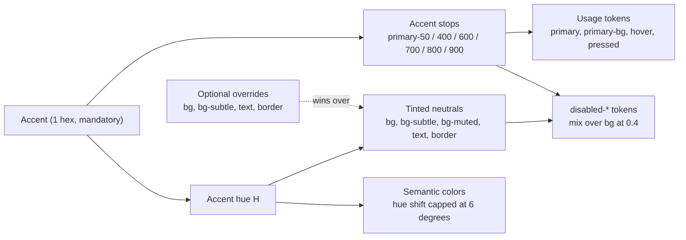
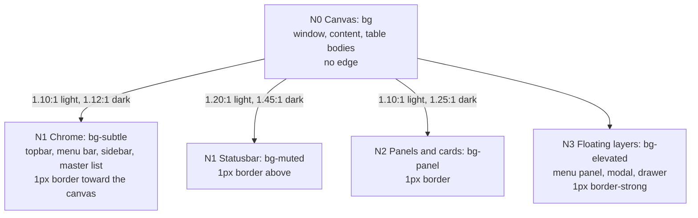
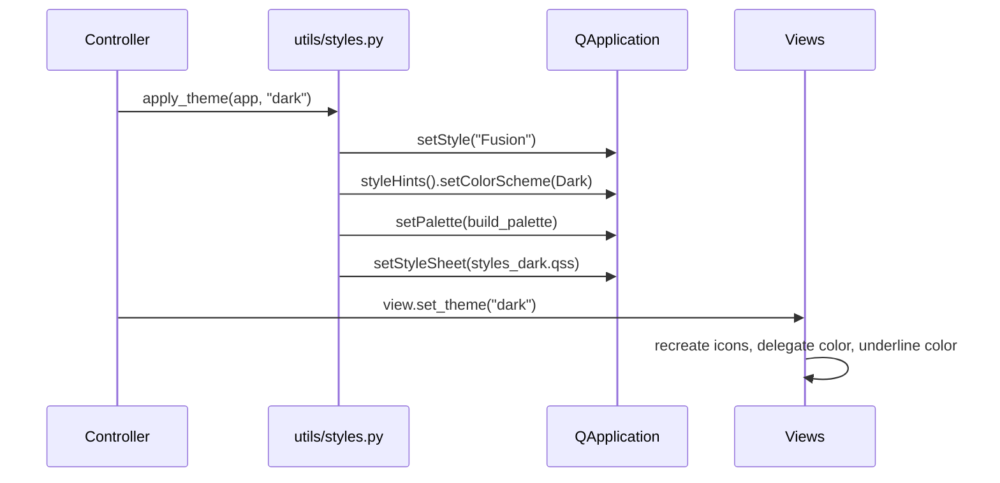

# Design System - v2.1 (Python / PySide6)

> Binding reference for all Python/PySide6 applications.
> Use: Windows desktop applications, personal and professional use.
> Inseparable from `layout.md` (v4.2).
> Colors, sizes and fonts live in two QSS sheets (`resources/styles_light.qss`, `resources/styles_dark.qss`); the few values QSS cannot hold live in `config.py`.
> Stack: Python 3.12+, PySide6 (Qt 6.8 or later), Fusion style, strict MVC.

**Visual language (v2.1)**: depth is expressed by the **stroke** (borders) and by a **four-level surface ladder** (fills spaced widely enough to be seen), never by shadows or elevation. Corners are softly rounded (5px). Neutrals carry a low tint of the project accent, so every generated application has its own atmosphere. Motion is discreet (`QPropertyAnimation` only, asymmetric deceleration) with **one** signature gesture: the sliding underline on tabs and horizontal navigation. Every state is readable without color alone, and every text and control pair is measured against WCAG 2.1 AA.

## Changelog

| Version | Date       | Main change |
| ------- | ---------- | ----------- |
| v2.1    | 2026-10-25 | **surface ladder** N0-N3 (canvas / chrome / panel / floating) with wider fill steps · new token `bg-panel` · neutral hex recomputed (`bg`, `bg-subtle`, `bg-muted`, `bg-elevated`, `border`, `border-subtle`, `border-strong`, `text-subtle`) · **accent AA darkening**: `primary-600` is darkened until white text, text on `bg` and text on `primary-50` reach 4.5:1 (default `#4682B4` → `#3D729E`); `primary-700/800` re-derived from it · new token `danger-fill` · topbar and menu bar on `bg-subtle`, modal on `bg-elevated` · control edge (field, Secondary button) = `border-strong` · neutral hover step transparent → `border-strong` · selected items carry a 2px `primary` bar painted by `SelectionBarDelegate` · pagination label and tree chevrons `text-subtle` · **Qt substitutes made explicit**: pre-blended `disabled-*` colors (QSS has no opacity), `overlay` rgba, ring in `text` on filled buttons, keyboard-only ring through `TabFocus`, `QPalette` for the roles QSS cannot reach, `QStyleHints.setColorScheme`, `InertScope` for the drawer, `Alert` accessibility event for danger toasts · measured sizes (§4) · section 14 lists what QSS cannot do and what to validate on Windows |
| v2.0    | 2026-07-16 | modernization: `radius` 0 → **5px** · typography → **system font** (QApplication default, no pinned family) · **accent-tinted neutrals** (all neutral roles derived from the accent hue; explicit palette roles still win) · **semantic colors derived per project** (fixed hue anchors, harmonized ±6° toward the accent; info = accent) · hover on neutral elements = **border strengthening** (replaces `bg-muted` fill) · easing `ease-out` (decelerate, `QEasingCurve.OutCubic`) 160/240ms via `config.ANIM_*` · **signature gesture**: sliding underline (tabs / horizontal nav, `QPropertyAnimation`) · icons qtawesome/Font Awesome → **Lucide** (vendored SVGs, stroke 1.75, `utils/icons.py` helper) · floating layers marked by `border-strong` (shadows still forbidden) |
| v1.6    | 2026-06-27 | default accent → **Steel Blue** `#4682B4` (chromatic in both themes, derived like the named palettes) · dark **surfaces** stay neutral grey · `onPrimary` stays a single white value · Teal kept as a named palette |
| v1.5    | 2026-06-20 | default accent → **Teal** `#0D9488` · dark surfaces stay neutral grey · grey-accent dark special-case removed |
| v1.4    | 2026-06-19 | full **palette** model (5 roles/theme) · named palette catalog + custom palette · WCAG AA check (warn) |
| v1.3    | 2026-06-14 | dark theme re-skin: 4-step dark surface ramp · Steel Blue primary (both modes) |
| v1.2    | 2026-06-14 | line-height · dark semantic backgrounds · WCAG AA target · layering scale |
| v1.1    | 2026-06-12 | Dark mode tokens · semantic palette |
| v1.0    | initial    | Typography, colors, spacing, components, states |

> This file shares the palette, the derivation model and every token value with the Electron `design-system.md v2.1`. Only the mechanics differ (QSS and `config.py` instead of CSS custom properties). The Flutter version is not updated by v2.1. Per-file versions: QSS rules in `rules/qss.md`, accent derivation in `rules/config.md`, layout in `layout.md`.

Every generated application references the active version in its `README.md`.

## Deviations from v2.0

Each row is a value or rule of v2.0 that v2.1 replaces, with the measured reason.

| Area | v2.0 | v2.1 | Reason |
| ---- | ---- | ---- | ------ |
| `primary-600` | `#4682B4` (the accent) | `#3D729E` (accent darkened, L 49 → 43) | white text, `primary` on `bg` and on `primary-50` reach 4.5:1 (were 4.11, 4.07, 3.67) |
| `primary-400` | `#5A9FD4` | `#91B6D4` | dark foreground accent re-derived at L≈70 % so selected text, ring and underline read on the new dark surfaces (8.60:1 on `bg`) |
| `primary-700`, `primary-800` | L≈50 and L≈42 | `primary-600` minus 3 and 6 L | hover was invisible and lower in contrast than the resting state |
| `primary-900` | `#2A4F72` | `#24425C` | dark selected background tuned to the new dark ramp |
| `text-subtle` | `#65717B` / `#94A2AD` | `#5A6670` / `#A3AEB8` | 4.5:1 on statusbar, toast and selected surfaces (were 4.41 to 4.47) |
| `border-strong` | `#96A4B0` / `#52626F` | `#6F8192` / `#768A9B` | 3:1 on every surface, `bg-muted` included (was 2.5:1) |
| Neutral surfaces | light `#FDFEFF`, `#F5F8FA`, `#EEF1F4`; dark `#181C20`, `#20272C`, `#293138`, `#252C32` | light `#FFFFFF`, `#F1F4F7`, `#E6EBF0`; dark `#111519`, `#1A2025`, `#2B343C`, `#222930` (`bg`, `bg-subtle`, `bg-muted`, dark `bg-elevated`) | fills were 1.06 to 1.13:1 apart and merged; wider steps carry the surface ladder |
| `border`, `border-subtle` | light `#E1E6EA`, `#ECF0F3`; dark `#323B43`, `#272F35` | light `#D3DAE1`, `#E3E8ED`; dark `#3A444D`, `#2A333A` | `border` on `bg` was 1.24:1 and 1.50:1, now 1.41:1 and 1.85:1 |
| `bg-panel` | not defined | `bg-subtle` light, `bg-elevated` dark | panel and card level N2 needs a different step per theme |
| Topbar and menu bar fill | `bg` | `bg-subtle` | chrome sits one level above the canvas |
| Modal fill | `bg` | `bg-elevated` | floating layer level N3; identical in light, one step lighter in dark |
| Danger fill | `danger-600` (light value in both themes, by prose) | token `danger-fill` = light `danger-600` | the dark `danger-600` (`#CB7282`) fails white text; a named token removes the ambiguity |
| Control edge | `border` | `border-strong` | WCAG 1.4.11: field and Secondary button boundary (was 1.24:1) |
| Neutral hover step | transparent → `border` | transparent → `border-strong`; bordered control → `text-subtle` | the system's own 3:1 hover rule |
| Selected item | background and text color | plus a 2px `primary` bar (leading edge; bottom edge for pagination) | WCAG 1.4.1: no color-only state |
| Pagination label, tree chevrons | `text-muted` | `text-subtle` | informational text and functional icons are not exempt from AA |
| Disabled state | `opacity-disabled` 40 % | pre-blended `disabled-*` colors | QSS has no `opacity`: each color is the token mixed over `bg` at 0.4 and written as a literal |
| Overlay | `text` 40 % opacity | `overlay` = `text` as `rgba(r, g, b, 102)` | QSS has no opacity; the rgba literal paints the scrim |
| Focus ring | 2px ring, offset 2px | 2px ring drawn inside the widget (no `outline-offset` in QSS); `text` color on Primary and Danger buttons | an inset ring on a filled button must contrast with the fill, `primary` on `primary-600` would be 1:1 |
| Focus visibility | always visible | buttons, icon buttons and tabs use `Qt.TabFocus`: ring for the keyboard only | equivalent of `:focus-visible`; text inputs show the ring on any focus |
| Item-view selection | background fill | plus the 2px bar from `SelectionBarDelegate` | `border-left` on `::item` shifts the content and cannot target the first column |
| Native roles | not specified | `QPalette` from `config.NATIVE_PALETTE` | placeholder text, tooltip base, sort arrow and disabled text are not reachable from QSS |
| Color scheme | not specified | `QStyleHints.setColorScheme` per theme | native popups and window frame follow the theme |

---

## 1. TYPOGRAPHY

| Token         | Value                          | Usage                                  |
| ------------- | ------------------------------ | -------------------------------------- |
| `font-family` | system font (no pinned family) | All applications                       |
| `xs`          | 12px                           | Statusbar, secondary labels            |
| `sm`          | 14px                           | Labels, subtitles, body, topbar tabs   |
| `base`        | 16px                           | Primary text, brand name               |
| `lg`          | 18px                           | Secondary section titles, modal and drawer titles |
| `xl`          | 20px                           | Intermediate titles                    |
| `2xl`         | 24px                           | Primary section titles                 |
| `normal`      | 400                            | Body, descriptions                     |
| `medium`      | 500                            | Labels, navigation items               |
| `semibold`    | 600                            | Titles, headers                        |
| `bold`        | 700                            | Primary titles                         |

> Do **not** set `font-family` in the QSS sheets. The `QApplication` default font is the native UI face of the host OS (Segoe UI Variable on Windows 11, Segoe UI on Windows 10). Zero embedded font, zero dependency; the application always looks native. QSS sets sizes and weights only. Pinning "Segoe UI" would freeze the Windows 10 face.
>
> Sizes are in `px` in QSS. Qt scales them with the screen device pixel ratio, not with the Windows "Text size" accessibility setting, which Qt widgets do not read. A user-adjustable base size is out of scope for this stack.

### Line-height

| Token            | Value | Usage                             |
| ---------------- | ----- | --------------------------------- |
| `leading-tight`  | 1.25  | Titles (`lg`, `2xl`)              |
| `leading-normal` | 1.5   | Body, labels (`xs`, `sm`, `base`) |

> QSS has no reliable `line-height`. These tokens are the target ratios, not a QSS property. Single-line widgets take the font's natural height; apply leading through margins, or `QTextOption` / `QTextDocument` for rich text.

### Numerals

Tables, statusbar counters and any column of figures use tabular digits and are right-aligned:

```python
font = widget.font()
font.setFeature(QFont.Tag("tnum"), 1)   # tabular numerals; not every font carries the feature
widget.setFont(font)
```

> `QFont.setFeature` takes a `QFont.Tag`, not a string. Whether Segoe UI Variable honors `tnum` is to validate on Windows (§14); right-alignment of numeric columns is the guaranteed part.

---

## 2. COLORS

A project's colors come from a **palette**. Only the **accent is mandatory**: every neutral role, the accent stops, and the semantic colors **derive** from it. The four other roles (main background, secondary background, text, details) remain available as **explicit overrides**: when provided, their values win over the derivation.

Token placement:

- **Neutrals and semantics**: literal hex in `resources/styles_light.qss` and `resources/styles_dark.qss`, each rule commented with its source token.
- **Values QSS cannot hold**: `config.py`: accent stops (`PRIMARY_400`, `PRIMARY_600`, `ON_PRIMARY`), `ICON_COLORS`, `NATIVE_PALETTE`, animation durations (`rules/config.md`).
- **A project may keep a QSS template with `{{token}}` placeholders and generate the two sheets from one token file.** The generated sheets are what the application loads and what review reads.



### Palette roles → tokens

| Role (palette)       | Mandatory | Drives          | Also derives |
| -------------------- | --------- | --------------- | ------------ |
| Accent               | yes       | `primary-600` (after the AA darkening below) | `primary-50/400/700/800/900`, `primary`, `primary-bg`, `selection-bg`, `focus-ring`, `text-on-primary`, `ICON_COLORS`, **all neutral tokens** (tinting rule below), **all semantic tokens** (harmonization rule below) |
| Main background      | optional  | `bg`            | `bg-elevated` (= `bg` in light), `bg-panel` |
| Secondary background | optional  | `bg-subtle`     | `bg-muted` (`bg-subtle` darkened ~3.5 % L) |
| Text                 | optional  | `text`          | `text-subtle` (mix text→bg ~45 %), `text-muted` (mix text→bg ~62 %) |
| Details              | optional  | `border`        | `border-subtle` (mix border→bg ~50 %), `border-strong` (mix border→text ~12 %) |

### Derivation rules (computed by Claude in Phase 1, written as literal hex)

**Accent stops** (same H/S as the accent, lightness varies): `primary-50` L≈95 %, `primary-400` L≈70 %, `primary-900` L≈25 %.

**AA darkening (new in v2.1).** `primary-600` is the accent, darkened in steps of 1 % lightness until three pairs all reach 4.5:1: white on it, it on `bg`, and it on `primary-50`. An accent that already passes keeps its value. `primary-700` is `primary-600` minus 3 % L and `primary-800` minus 6 % L, so hover and pressed stay visible and never lose contrast. `text-on-primary` is `#FFFFFF`: after the darkening, white always passes. Method (`colorsys`): `rules/config.md`.

Usage tokens: `primary` = `primary-600` (light) / `primary-400` (dark); `primary-bg` = `primary-50` (light) / `primary-900` (dark).

**Tinted neutrals.** Let **H** be the accent hue. Every neutral token is `hsl(H, S, L)` with the fixed S/L targets below. The tint is atmospheric, never saturated: S stays ≤ 33 % in light, ≤ 24 % in dark. When an optional palette role is provided, its explicit value replaces the tinted target for that token, and its supporting tokens derive from it by the mix rules of the role table above.

| Token             | Light `hsl(H, S%, L%)` | Dark `hsl(H, S%, L%)` |
| ----------------- | ---------------------- | --------------------- |
| `bg`              | 0, 100                 | 19, 8                 |
| `bg-subtle`       | 27, 96                 | 17, 12                |
| `bg-elevated`     | = `bg`                 | 17, 16                |
| `bg-muted`        | 25, 92                 | 17, 20                |
| `bg-panel`        | = `bg-subtle`          | = `bg-elevated`       |
| `text`            | 33, 9                  | 24, 96                |
| `text-subtle`     | 11, 40                 | 13, 68                |
| `text-muted`      | 12, 64                 | 11, 42                |
| `border`          | 19, 86                 | 14, 26                |
| `border-subtle`   | 22, 91                 | 16, 20                |
| `border-strong`   | 14, 50                 | 16, 54                |

> Light `bg` is pure white (S 0): the tint lives in the surfaces beneath it. Dark surface ramp stays ascending: `bg` < `bg-subtle` < `bg-elevated` < `bg-muted`, so hover stays visible on every surface, including inside drawers and modals.

### Surface ladder

Depth is the fill and the stroke together. Four levels, each with an assigned fill and edge.



| Level | Role | Light | Dark | Edge | QSS selector |
| ----- | ---- | ----- | ---- | ---- | ------------ |
| N0 | Canvas: window, content, table bodies | `bg` | `bg` | none | `QMainWindow`, `QFrame#main_content`, `QTableView#data_table` |
| N1 | Chrome: topbar, menu bar, sidebar, master list | `bg-subtle` | `bg-subtle` | 1px `border` toward the canvas | `QFrame#topbar`, `QMenuBar#menu_bar`, `QFrame#sidebar`, `QListWidget#master_list` |
| N1 | Statusbar | `bg-muted` | `bg-muted` | 1px `border` above | `QStatusBar#statusbar` |
| N2 | Panels and cards | `bg-panel` (`bg-subtle`) | `bg-panel` (`bg-elevated`) | 1px `border` | `QFrame[surface="panel"]` |
| N3 | Floating layers: menu panel, modal, drawer | `bg-elevated` (= `bg`) | `bg-elevated` | 1px `border-strong` | `QMenu`, `QFrame#modal`, `QFrame#drawer` |

- Chrome frames the canvas: never put a topbar, menu bar or footer on `bg`.
- A table body stays on `bg`. On a panel, frame it with a 1px `border`; its header is `bg-subtle`.
- Measured steps from the canvas (contrast ratio of the fill against `bg`): chrome 1.10:1 light and 1.12:1 dark, panel 1.10:1 and 1.25:1, statusbar 1.20:1 and 1.45:1, `border` 1.41:1 and 1.85:1.
- In light, `primary-bg` on `bg-subtle` is 1.01:1, so a selected item on chrome or on a panel is told by its 2px `primary` bar and its `primary` text, never by the fill.

### Default palette - Steel Blue accent `#4682B4` (H = 207), computed hex

Light (`styles_light.qss`):

| Token             | Value   | Token             | Value   |
| ----------------- | ------- | ----------------- | ------- |
| `bg`              | #FFFFFF | `text`            | #0F181E |
| `bg-subtle`       | #F1F4F7 | `text-subtle`     | #5A6670 |
| `bg-muted`        | #E6EBF0 | `text-muted`      | #98A4AE |
| `bg-elevated`     | #FFFFFF | `border`          | #D3DAE1 |
| `bg-panel`        | #F1F4F7 | `border-subtle`   | #E3E8ED |
| -                 | -       | `border-strong`   | #6F8192 |

Dark (`styles_dark.qss`, derived):

| Token             | Value   | Token             | Value   |
| ----------------- | ------- | ----------------- | ------- |
| `bg`              | #111519 | `text`            | #F2F5F7 |
| `bg-subtle`       | #1A2025 | `text-subtle`     | #A3AEB8 |
| `bg-elevated`     | #222930 | `text-muted`      | #5F6C77 |
| `bg-muted`        | #2B343C | `border`          | #3A444D |
| `bg-panel`        | #222930 | `border-subtle`   | #2A333A |
| -                 | -       | `border-strong`   | #768A9B |

Accent stops (mode-agnostic, written once to `config.py`):

| Token           | Value   | Token           | Value   |
| --------------- | ------- | --------------- | ------- |
| `primary-50`    | #EDF3F8 | `primary-700`   | #396A93 |
| `primary-400`   | #91B6D4 | `primary-800`   | #356388 |
| `primary-600`   | #3D729E | `primary-900`   | #24425C |

> Hex values are computed from the HSL targets and the AA darkening; re-check with a contrast tool before shipping (Phase 1 runs the AA check, §12).

### Named palettes (Phase 1 catalog)

`p1-scoping` presents these. A preset is defined by its **accent alone**; the four optional roles may still be listed to override the tint (e.g. Amber warms its backgrounds beyond the rule). The accent is the source color; `primary-600` is the value after the AA darkening. Custom palettes: 1 mandatory hex (accent) + up to 4 optional overrides.

| Name                 | Accent  | `primary-600` | White on `primary-600` | `primary-600` on `bg` | Optional overrides                    |
| -------------------- | ------- | ------------- | ---------------------- | --------------------- | ------------------------------------- |
| Steel Blue (default) | #4682B4 | #3D729E       | 5.12                   | 5.12                  | -                                     |
| Teal                 | #0D9488 | #0B7F74       | 4.88                   | 4.88                  | -                                     |
| Forest               | #059669 | #04805A       | 4.95                   | 4.95                  | -                                     |
| Slate                | #4F46E5 | #4F46E5       | 6.29                   | 6.29                  | -                                     |
| Amber                | #B45309 | #B45309       | 5.02                   | 4.95                  | Main bg #FFFDFB, Secondary bg #FBF6EF |
| Ruby                 | #BE123C | #BE123C       | 6.29                   | 6.29                  | -                                     |

> "Slate" is an indigo (hue 243), not a slate grey: the name comes from the original catalog.

### Native color scheme and palette

QSS styles the widgets it reaches; the rest (placeholder text, tooltip base, the native sort arrow, disabled text of unstyled widgets, native popups and the window frame) read the application `QPalette` and the Qt color scheme. Both are set on every theme change, together with the sheet:

```python
# utils/styles.py - one function applies a theme, by complete replacement
def apply_theme(app: QApplication, theme: str) -> None:
    app.setStyle("Fusion")                                   # mandatory: the native Windows style ignores part of the QSS
    app.styleHints().setColorScheme(
        Qt.ColorScheme.Dark if theme == "dark" else Qt.ColorScheme.Light  # Qt 6.8+; Unknown would follow the OS
    )
    app.setPalette(build_palette(theme))                     # config.NATIVE_PALETTE[theme]
    app.setStyleSheet(load_stylesheet(theme))                # styles_<theme>.qss, never a partial override
```

```python
# config.py - same values as the sheets
NATIVE_PALETTE = {
    "light": {"window": "#FFFFFF", "window_text": "#0F181E", "base": "#FFFFFF", "text": "#0F181E",
              "button": "#FFFFFF", "button_text": "#0F181E", "highlight": "#EDF3F8", "highlighted_text": "#0F181E",
              "placeholder": "#5A6670", "tooltip_base": "#FFFFFF", "tooltip_text": "#0F181E",
              "link": PRIMARY_600, "disabled_text": "#9FA3A5"},
    "dark":  {"window": "#111519", "window_text": "#F2F5F7", "base": "#111519", "text": "#F2F5F7",
              "button": "#111519", "button_text": "#F2F5F7", "highlight": "#24425C", "highlighted_text": "#F2F5F7",
              "placeholder": "#A3AEB8", "tooltip_base": "#222930", "tooltip_text": "#F2F5F7",
              "link": PRIMARY_400, "disabled_text": "#6B6F72"},
}
```



> Palette values are the sheet values: `window`/`base` = `bg`, `text` = `text`, `placeholder` = `text-subtle`, `highlight` = `primary-bg`, `tooltip_base` = `bg-elevated`. The disabled text color is the pre-blended `disabled-text`.

### Accent - usage tokens

The stops are mode-agnostic; only the usage tokens flip per theme. Replacing the `PRIMARY_*` stops in `config.py` plus the derived neutrals and semantics in both sheets changes the accent across the whole application.

| Token         | Value   | Usage                                                         |
| ------------- | ------- | ------------------------------------------------------------- |
| `primary-50`  | #EDF3F8 | Selection / active bg (light)                                 |
| `primary-400` | #91B6D4 | Active text, ring, underline, icon (dark): reads on the dark `bg` |
| `primary-600` | #3D729E | Primary button fill (both themes); active text, ring, underline, icon (light) |
| `primary-700` | #396A93 | Primary button hover (`primary-hover`)                        |
| `primary-800` | #356388 | Primary button pressed (`primary-pressed`)                    |
| `primary-900` | #24425C | Selection / active bg (dark)                                  |

### Semantic colors (derived - harmonized with the project atmosphere)

Semantic colors keep **fixed hue anchors** so the meaning never drifts, but their exact hue/saturation/lightness are **derived per project** so they share the tinted atmosphere of the neutrals. **Info is the accent itself.**

**Derivation rule.** Let **Ha** be the accent hue and **Hs** the anchor hue of a semantic color. The harmonized hue is:

```
Hs' = Hs + clamp(shortest_angle(Ha − Hs), −10°, +10°) × 0.6      → shift capped at ±6°
```

| Semantic | Anchor Hs | Light `*-600` `hsl(Hs', S%, L%)` | Dark `*-600` `hsl(Hs', S%, L%)` |
| -------- | --------- | -------------------------------- | ------------------------------- |
| success  | 152       | S 48, L 38                       | S 42, L 60                      |
| warning  | 38        | S 62, L 40                       | S 56, L 60                      |
| danger   | 355       | S 52, L 48                       | S 46, L 62                      |
| info     | = accent  | `info-600` = `primary-600`       | `info-600` = `primary-400`      |

**Surface tokens** (`*-50`, toast backgrounds):
- Light: `*-50` = sRGB mix of `bg` 92 % + `*-600` 8 %.
- Dark: `*-50` = sRGB mix of `bg` 82 % + dark `*-600` 18 %.
- Info: `info-50` = `primary-bg`.

> The default-palette `*-50` values below keep their v2.0 hex. They were not re-derived from the v2.1 `bg`; they still pass the pairs listed in §12.

> Naming note: `*-50` is a **role** ("semantic surface / toast background"), not a fixed luminance level. Light = pale tint, dark = deep tint of the same hue; each sheet holds its own value, so the toast stays readable in both themes.

**Danger button stops**: the fill is the light `danger-600` in **both** themes, exposed as the token `danger-fill`, with white `text-on-danger`. `danger-700` = light `danger-600` at L −7 %; `danger-800` at L −13 %.

Default palette (accent H 207) computed hex:

| Token           | Light               | Dark                | Usage                           |
| --------------- | ------------------- | ------------------- | ------------------------------- |
| `success-50`    | #EFF6F3             | #26372F             | Success toast bg                |
| `success-600`   | #328F6D             | #6EC4A4             | Success border, icon            |
| `warning-50`    | #F8F5EC             | #392F1B             | Warning toast bg                |
| `warning-600`   | #A58327             | #D2B460             | Warning border, icon            |
| `danger-50`     | #F8EFF1             | #38222B             | Danger toast bg                 |
| `danger-600`    | #BA3B52             | #CB7282             | Danger border, icon, error text |
| `danger-fill`   | #BA3B52             | #BA3B52             | Danger button fill              |
| `danger-700`    | #A23448             | #A23448             | Danger button hover             |
| `danger-800`    | #8A2C3D             | #8A2C3D             | Danger button pressed           |
| `info-50`       | = `primary-bg`      | = `primary-bg`      | Info toast bg                   |
| `info-600`      | = `primary`         | = `primary`         | Info border, icon               |

> The ±6° cap keeps every semantic color instantly recognizable across projects (a danger is always red-family, a success always green-family). Toast message text uses `text`; border and icon use `*-600`. Every `*-600`/`*-50` pair must pass the §12 checks; Phase 1 verifies and reports. Pair every status color with a word or an icon.

### Charts / visualization palette

Charts consume the semantic values per theme, so series stay legible against either background.

| Token           | Light           | Dark            |
| --------------- | --------------- | --------------- |
| `chart-primary` | `primary-600`   | `primary-400`   |
| `chart-success` | `success-600`   | `success-600` dark |
| `chart-warning` | `warning-600`   | `warning-600` dark |
| `chart-danger`  | `danger-600`    | `danger-600` dark  |
| `chart-info`    | `info-600`      | `info-600` dark    |

- Hue alone never separates two series (success and danger differ by 1.4:1 in lightness): add a marker shape, a dash pattern or a direct label, and keep at least 1.5:1 of lightness between neighbouring series.
- `chart-info` equals `chart-primary` (info is the accent): never plot both in one chart.

### Text selection and on-primary

| Token            | Light         | Dark          | Usage                         |
| ---------------- | ------------- | ------------- | ----------------------------- |
| `selection-bg`   | `primary-50`  | `primary-900` | Selected text background (`selection-background-color`) |
| `selection-text` | `text`        | `text`        | Selected text color (`selection-color`) |
| `text-on-primary`| #FFFFFF       | #FFFFFF       | Text on Primary button        |
| `text-on-danger` | #FFFFFF       | #FFFFFF       | Text on Danger button (fixed) |

> `text-on-primary` and `text-on-danger` stay separate tokens so a custom accent dark enough to need a near-black `text-on-primary` does not drag the Danger button along (the danger fill keeps white text in both themes). `ON_PRIMARY` in `config.py` mirrors `text-on-primary` for icons drawn on a filled button.

### Disabled colors and overlay (Qt)

QSS has no `opacity`, so `opacity-disabled` and `opacity-overlay` become literals computed once per theme: the token mixed over `bg` at 0.4 (sRGB), or `text` with an alpha channel.

| Token                    | Definition                          | Light     | Dark      | Used by |
| ------------------------ | ----------------------------------- | --------- | --------- | ------- |
| `disabled-text`          | `text` over `bg` at 0.4             | #9FA3A5   | #6B6F72   | Secondary label, field text |
| `disabled-text-subtle`   | `text-subtle` over `bg` at 0.4      | #BDC2C6   | #4B5259   | Ghost label |
| `disabled-border-strong` | `border-strong` over `bg` at 0.4    | #C5CDD3   | #39444D   | Secondary and field edge |
| `disabled-primary`       | `primary-600` over `bg` at 0.4      | #B1C7D8   | #233A4E   | Primary fill |
| `disabled-danger`        | `danger-fill` over `bg` at 0.4      | #E3B1BA   | #552430   | Danger fill |
| `disabled-on-primary`    | `text-on-primary` over `bg` at 0.4  | #FFFFFF   | #707375   | Label on a disabled filled button |
| `overlay`                | `text` at alpha 0.4                 | rgba(15, 24, 30, 102) | rgba(242, 245, 247, 102) | Modal and drawer scrim |

> Disabled elements are exempt from AA. A pre-blended color is correct only over the surface it was computed for (`bg`); a disabled control on `bg-subtle` or `bg-panel` reads about 2 % off, which is accepted.

---

## 3. SPACING

Unchanged from v2.0, plus `spacing-7`.

| Token       | Value | Usage                     |
| ----------- | ----- | ------------------------- |
| `spacing-1` | 4px   | Micro-spacing             |
| `spacing-2` | 8px   | Compact inner padding     |
| `spacing-3` | 12px  | Standard padding          |
| `spacing-4` | 16px  | Inter-element spacing     |
| `spacing-5` | 20px  | Intermediate spacing      |
| `spacing-6` | 24px  | Main content padding      |
| `spacing-7` | 28px  | Wide intermediate spacing |
| `spacing-8` | 32px  | Major separation          |

> In QSS the values are literals. In code (`setContentsMargins`, `setSpacing`) they are the documented numeric exceptions listed in §11 rule 1; each call carries a `# token: spacing-N` comment.

---

## 4. COMPONENT SIZES

Fixed anchors, measured results and the dynamic sizing principle.

### Fixed sizes (global visual anchors)

| Token              | Value  | Usage                                   |
| ------------------ | ------ | --------------------------------------- |
| `topbar-height`    | 48px   | Topbar height (minimum: grows with text) |
| `statusbar-height` | 28px   | Statusbar height                        |
| `drawer-width`     | 320px  | Right drawer width                      |
| `content-xl`       | 1024px | Max centered content width              |
| `toast-width`      | 320px  | Toast width                             |
| `modal-min-width`  | 480px  | Modal minimum width                     |
| `sidebar-width`    | 240px  | Vertical sidebar, expanded (P2)         |
| `master-width`     | 320px  | Master list width (P4)                  |
| `menubar-height`   | 32px   | Menu bar height (P3, minimum)           |
| `menu-min-width`   | 200px  | Menu panel minimum width (P3)           |
| `icon-sm`          | 16px   | Small icon                              |
| `icon-md`          | 20px   | Standard icon                           |
| `icon-lg`          | 24px   | Navigation / topbar icon                |

### Measured sizes (Fusion, offscreen render, 14px Inter)

| Element | Measured | Rule that produces it |
| ------- | -------- | --------------------- |
| Topbar | 48px | `setMinimumHeight(48)` on the topbar frame (`topbar-height`); it grows with the text |
| Navigation tab | 47px | tab `min-height: 45px` plus its two 1px borders; with the topbar's 1px bottom border it fills the 48px bar |
| Statusbar | 28px | `min-height: 27px` plus the 1px top border |
| Menu bar | 33px | padding 3px, item padding 4px 12px, 1px border; font-dependent, see §14 |
| Button `sm` / `md` / `lg` | 25 / 35 / 46px | padding `spacing-1` / `spacing-2` / `spacing-3` around the font height |
| Icon button `md` / `sm` | 41 / 29px | QToolButton padding 6px / 2px; Fusion adds 3px to a QToolButton |
| Field | 37px | padding `spacing-2` + 1px border around the font height |

> The heights marked font-dependent are measured with the font available in the build environment (Inter). Segoe UI Variable has different vertical metrics: re-measure on Windows (§14). The reference build measures these sizes and compares a button's box with and without focus; any change in a bar height or a focus-state size is a regression.

### Dynamic sizes - general principle

**Rule**: no component has a fixed height or width except the documented exceptions above. Dimensions result from content + padding.

| Component         | Width                                        | Height                     | Exception                                     |
| ----------------- | -------------------------------------------- | -------------------------- | --------------------------------------------- |
| Button            | content + horizontal padding                 | content + vertical padding | aligned group: unified on the widest          |
| Input field       | stretches in its container (`setSizePolicy(Expanding, Fixed)`) | content + vertical padding | -                         |
| Table column      | content (`resizeColumnsToContents`), last column stretches | -            | actions column: fixed                         |
| Topbar tab        | label + horizontal padding                   | fills the topbar           | -                                             |
| Label             | content, wrap if constrained                 | content                    | -                                             |
| Dropdown menu     | longest item                                 | content                    | `min-width` 200px                             |
| Dialog / modal    | content                                      | content                    | min-width 480px (see `layout.md` §8)          |
| Tree item         | content + indentation                        | vertical padding           | -                                             |
| Toast             | -                                            | multi-line content         | fixed width 320px                             |

> **QSS box model.** `min-height` and `min-width` exclude the border, and `padding` is added inside it. A bar that must measure N px with a 1px border carries `min-height: N-1`. Set a fixed height from a token only through `min-height` on the bar itself, never through `setFixedHeight` on its children.

---

## 5. SHAPE, SHADOWS, BORDERS, OPACITY

**The stroke is the language of depth.** An element detaches from the background by its border, never by a shadow. Hierarchy = border strength: `border-subtle` < `border` < `border-strong`. Fills follow the surface ladder (§2). Floating layers (menu panel, modal, drawer) use `border-strong` on `bg-elevated`: that is their elevation; the toast's stroke marker is its 4px semantic left accent (`layout.md §5`).

| Token    | Value                                              |
| -------- | -------------------------------------------------- |
| `radius` | 5px, uniform                                       |
| shadow   | none: `QGraphicsDropShadowEffect` forbidden        |

> `radius` applies to every rounded element: buttons, fields, cards, toasts, modals, badges (`border-radius: 5px` in QSS). Nested radius (e.g. menu items inside a 5px menu): 3px (`radius` - 2). Shadows remain forbidden in QSS and in code.

### Edges

- **Control edge.** The border of a control (field, Secondary button) is `border-strong`: 3:1 against the surface (WCAG 1.4.11). `border` is a decorative separator and never the only boundary of a control.
- **Transparent border.** A borderless interactive item always carries `border: 1px solid transparent` in QSS, so hover never shifts layout. Hover climbs it to `border-strong` (3:1).
- **Selection.** A selected item never relies on color alone: list items and rows carry a 2px `primary` bar on the leading edge (painted by `SelectionBarDelegate`), pagination a 2px bar on the bottom edge (QSS `border-bottom`), tabs the sliding underline.

### Border widths

| Token                   | Value | Usage                                                     |
| ----------------------- | ----- | --------------------------------------------------------- |
| `border-width`          | 1px   | Standard borders, separators                              |
| `border-width-emphasis` | 2px   | Focus, signature underline, selection bar, field-in-error |
| `border-width-accent`   | 4px   | Toast left accent                                         |

### Opacity

| Token              | Value | Usage                                                  |
| ------------------ | ----- | ------------------------------------------------------ |
| `opacity-disabled` | 40%   | Disabled interactive elements (realized by `disabled-*`, §2) |
| `opacity-overlay`  | 40%   | Modal / drawer overlay, `text` color (realized by `overlay`, §2) |

---

## 6. TRANSITIONS

A single asymmetric easing (fast start, soft landing). QSS cannot animate: state changes (hover, focus, press) apply **instantly**, which is accepted. Animation exists only where Qt code drives it (`QPropertyAnimation`).

| Token / constant     | Value                         | Usage                                      |
| -------------------- | ----------------------------- | ------------------------------------------ |
| `ease-out`           | `QEasingCurve.Type.OutCubic`  | Every animation                            |
| `ANIM_DEFAULT_MS`    | 160 (`config.py`)             | Reserved for short functional animations   |
| `ANIM_SLOW_MS`       | 240 (`config.py`)             | Drawer slide, signature underline          |
| `ANIMATIONS_ENABLED` | `True` by default (`config.py`) | Set at startup from the OS; `False` snaps every animation |

**Motion policy**: the **drawer slide** (functional panel movement) and the **signature underline** (§8) are the only animated visuals. No entry animations on menus, modals or toasts; QSS state changes stay instant. The underline is the only *expressive* movement in the system.

```python
# utils/helpers.py - read once at startup (Windows only; returns True elsewhere)
def animations_enabled() -> bool:
    if sys.platform != "win32":
        return True
    import ctypes
    enabled = ctypes.c_int(1)
    SPI_GETCLIENTAREAANIMATION = 0x1042
    ctypes.windll.user32.SystemParametersInfoW(SPI_GETCLIENTAREAANIMATION, 0, ctypes.byref(enabled), 0)
    return bool(enabled.value)
```

> The `SystemParametersInfoW` call is the documented Windows API for "Show animations in Windows". It was not exercised in the reference build (no Windows host): validate it on Windows (§14).

---

## 7. FOCUS

| Token        | Light                   | Dark                    |
| ------------ | ----------------------- | ----------------------- |
| `focus-ring` | 2px solid `primary-600` | 2px solid `primary-400` |

QSS has no `outline` and no `outline-offset`. The ring is the widget's own border, drawn **inside** its box:

- The default state carries a 1px border (transparent or `border-strong`). On `:focus` the border becomes 2px `primary` and the padding shrinks by 1px on each side, so the size never changes (verified: a button group keeps the same height with and without focus).
- **Filled buttons** (Primary, Danger): the ring is `text`, not `primary`. `primary` on a `primary-600` fill is 1:1 and would vanish. `text` on `primary-600` measures 3.50:1 light and 4.68:1 dark; `text` on `danger-fill` 3.28:1 and 5.00:1. Both pass the 3:1 UI-component rule.
- **Keyboard only.** Qt has no `:focus-visible`. Buttons, icon buttons and tab bars use `Qt.FocusPolicy.TabFocus`, so a mouse click does not show the ring and a Tab press does. Text inputs show the ring on any focus (the caret already signals focus).
- **Item views** (table, tree, lists): `::item:focus` draws the ring inset on the item.
- Never remove the ring: `QWidget:focus { border: none; }` is forbidden.

```python
class Button(QPushButton):
    """Text button. TabFocus: the ring shows for the keyboard only (the :focus-visible equivalent)."""

    def __init__(self, text: str, variant: str = "secondary", size: str = "md", parent: QWidget | None = None) -> None:
        super().__init__(text, parent)
        self.setProperty("variant", variant)
        self.setProperty("btnSize", size)          # never name a dynamic property "size": it collides with QWidget.size
        self.setFocusPolicy(Qt.FocusPolicy.TabFocus)
        self.setCursor(Qt.CursorShape.PointingHandCursor)
```

---

## 8. INTERACTIVE COMPONENT STATES

Applies to **neutral interactive elements**: tabs, list/table/tree items, pagination buttons, Secondary and Ghost buttons. Colored-background buttons (Primary, Danger) follow §9.

**Hover is a stroke event, not a fill event.** On hover, the element's border climbs one step. Elements without a visible border always carry a **transparent 1px border** in QSS so hover never shifts layout.

| State      | Rule |
| ---------- | ---- |
| `default`  | Base style; borderless items have `border: 1px solid transparent` |
| `:hover`   | Border climbs one step: transparent → `border-strong` (3:1 against the surface); a bordered control (`border-strong`) → `text-subtle`. Wide table rows strengthen their bottom border and may add `bg-subtle` as a secondary cue. Instant (QSS cannot transition) |
| `:pressed` | `bg-muted` background (transient press feedback) |
| `:selected` | `primary-bg` background, `primary` text, **and a 2px `primary` bar on the leading edge** (bottom edge for pagination). Tabs / horizontal nav instead use the **signature underline** (below) |
| `:disabled` | `disabled-*` colors (§2), non-interactive |
| `:focus`   | `focus-ring` visible (§7) |

> `:selected` (persistent) remains distinct from `:pressed` (transient mouse-down). Do not conflate them.

**Dynamic properties.** A state that QSS has no pseudo-class for (`variant`, `btnSize`, `selected`, `error`, `active`, `tone`) is a dynamic property read by an attribute selector: `QPushButton[variant="primary"]`. Qt does not re-evaluate the sheet when a property changes after the widget is shown: call `repolish(widget)` (`widget.style().unpolish(widget); widget.style().polish(widget)`) after `setProperty`.

### Selection bar

QSS cannot paint a single-edge bar on an item. `border-left` on `::item:selected` shifts the content and applies to every column. A delegate paints it on the first column, after the standard item drawing:

```python
class SelectionBarDelegate(QStyledItemDelegate):
    """Paints the 2px leading selection bar (QSS cannot paint it on item views)."""

    def __init__(self, theme: str, parent: QWidget | None = None) -> None:
        super().__init__(parent)
        self._color = config.PRIMARY_600 if theme == "light" else config.PRIMARY_400

    def set_theme(self, theme: str) -> None:
        self._color = config.PRIMARY_600 if theme == "light" else config.PRIMARY_400

    def paint(self, painter: QPainter, option: QStyleOptionViewItem, index: QModelIndex) -> None:
        super().paint(painter, option, index)
        if option.state & QStyle.StateFlag.State_Selected and index.column() == 0:
            x = 0 if isinstance(option.widget, QTreeView) else option.rect.left()   # tree rows start at the viewport edge
            painter.fillRect(QRect(x, option.rect.top(), 2, option.rect.height()), self._color)
```

### Signature gesture - the sliding underline

The selected indicator of **tabs and horizontal navigation** is a 2px accent underline that **slides** from the previous item to the new one (240ms, `OutCubic`). It is the identity gesture of the system: implement it wherever a horizontal selection exists, and nowhere else.

Reference implementation, a dedicated widget `views/sliding_underline.py` (PySide6 only, no business logic):

```python
"""Signature underline: the only expressive animated visual (design-system section 6 and 8)."""

from PySide6.QtCore import QEasingCurve, QPropertyAnimation, QRect, Qt
from PySide6.QtWidgets import QWidget

import config

_HEIGHT = 2  # token: border-width-emphasis


class SlidingUnderline(QWidget):
    """2px accent bar overlaid on the tab row; slides to the active tab."""

    def __init__(self, parent: QWidget, theme: str) -> None:
        super().__init__(parent)
        self.setAttribute(Qt.WidgetAttribute.WA_StyledBackground, True)  # a plain QWidget ignores its background otherwise
        self.setFixedHeight(_HEIGHT)
        self.apply_theme(theme)
        self._anim = QPropertyAnimation(self, b"geometry", self)
        self._anim.setDuration(config.ANIM_SLOW_MS)
        self._anim.setEasingCurve(QEasingCurve.Type.OutCubic)

    def apply_theme(self, theme: str) -> None:
        accent = config.PRIMARY_600 if theme == "light" else config.PRIMARY_400
        self.setStyleSheet(f"background-color: {accent};")  # accent from config PRIMARY_* (documented exception)

    def slide_to(self, x: int, width: int, y: int, animate: bool = True) -> None:
        target = QRect(x, y, width, _HEIGHT)
        self._anim.stop()
        if not animate or not config.ANIMATIONS_ENABLED:
            self.setGeometry(target)
            return
        self._anim.setStartValue(self.geometry())
        self._anim.setEndValue(target)
        self._anim.start()
```

- Wiring: on tab change, the view calls `slide_to` with the active tab's `tabRect` (animated); on resize and on first show, it calls it with `animate=False` (snap). The QSS selected-tab rule has no bottom border: the widget **is** the indicator.
- With `config.ANIMATIONS_ENABLED = False` (reduced motion, §12) the underline snaps.
- Semantics: a `QTabBar` that switches views of a `QStackedWidget`. Qt exposes it as a tab list to assistive technology; the application names it ("Navigation principale").

---

## 9. BUTTONS

| Variant    | Background      | Text              | Border                |
| ---------- | --------------- | ----------------- | --------------------- |
| Primary    | `primary-600`   | `text-on-primary` | 1px transparent       |
| Secondary  | transparent     | `text`            | 1px `border-strong`   |
| Danger     | `danger-fill`   | `text-on-danger`  | 1px transparent       |
| Ghost      | transparent     | `text-subtle`     | 1px transparent       |

**States per variant**:

| Variant   | `:hover`                                  | `:pressed`          | `:disabled`                                  | `:focus` ring |
| --------- | ----------------------------------------- | ------------------- | -------------------------------------------- | ------------- |
| Primary   | `primary-hover`                           | `primary-pressed`   | `disabled-primary` fill, `disabled-on-primary` text | `text` |
| Danger    | `danger-700`                              | `danger-800`        | `disabled-danger` fill, `disabled-on-primary` text  | `text` |
| Secondary | border → `text-subtle`                    | `bg-muted` bg       | `disabled-border-strong` edge, `disabled-text` text | `primary` |
| Ghost     | border → `border-strong`, text → `text`   | `bg-muted` bg       | `disabled-text-subtle` text                         | `primary` |

> Secondary and Ghost hover by **stroke** (§8), not by `bg-muted` fill. Colored buttons keep their own darkening stops. Every variant carries a 1px border (transparent on Primary, Danger and Ghost) so all variants share one box and hover never shifts layout.
>
> Primary fill uses `primary-600` in **both** themes with `text-on-primary` (the brighter `primary-400` is reserved for dark foreground accents: active text, icons, ring, underline). Danger fill uses `danger-fill` in both themes with white `text-on-danger`. Contrast: white on `primary-600` 5.12:1, on `primary-hover` 5.74:1, on `primary-pressed` 6.38:1; white on `danger-fill` 5.48:1.

**Dynamic sizing**: the size results from content + padding (`btnSize` property):

| Size              | Vertical padding     | Horizontal padding   | Font                   | Measured |
| ----------------- | -------------------- | -------------------- | ---------------------- | -------- |
| `sm`              | `spacing-1` (4px)    | `spacing-3` (12px)   | `medium` `xs` (12px)   | 25px     |
| `md` (default)    | `spacing-2` (8px)    | `spacing-4` (16px)   | `medium` `sm` (14px)   | 35px     |
| `lg`              | `spacing-3` (12px)   | `spacing-6` (24px)   | `medium` `base` (16px) | 46px     |

**Aligned button group**: width unified on the widest button (`setMinimumWidth` on all, from the largest `sizeHint().width()`).

**Icon-only button**: a `QToolButton` (`role="icon"`), not a `QPushButton`: a `QPushButton` keeps a minimum width and ends wider than tall. Padding `spacing-2` around a 24px glyph (`md`), `spacing-1` around a 16px glyph (`sm`); Fusion adds 3px to a `QToolButton`, so the QSS padding is 6px and 2px to land on 41px and 29px. It always carries a tooltip and an accessible name with the same text.

---

## 10. ICONS - Lucide (vendored SVGs)

Library model: **vendored Lucide SVGs** in `resources/icons/`: only the icons the app actually uses, copied at generation time from the npm `lucide-static` package or the official Lucide repository (ISC license). Zero runtime icon dependency.

Stroke icons at 1.5-2px speak the same stroke language as the borders (§5); the framework stroke width is **1.75**. No emoji, no icon font, no filled glyph.

**Rendering.** Lucide SVGs use `stroke="currentColor"`, which `QIcon` cannot resolve. `utils/icons.py` (a pure function, delivered with every app) loads the SVG text, substitutes the color and the stroke width, and renders a `QIcon` through `QtSvg` at the screen device pixel ratio:

```python
@lru_cache(maxsize=512)
def get_icon(name: str, color_key: str, theme: str, size: int) -> QIcon:
    """Render resources/icons/<name>.svg in ICON_COLORS[theme][color_key] at <size> logical px."""
    svg = _recolored_svg(name, config.ICON_COLORS[theme][color_key])
    renderer = QSvgRenderer(QByteArray(svg.encode("utf-8")))
    dpr = QGuiApplication.primaryScreen().devicePixelRatio() if QGuiApplication.primaryScreen() else 1.0
    pixmap = QPixmap(int(size * dpr), int(size * dpr))
    pixmap.setDevicePixelRatio(dpr)
    pixmap.fill(Qt.GlobalColor.transparent)
    painter = QPainter(pixmap)
    renderer.render(painter, QRectF(0, 0, size, size))
    painter.end()
    return QIcon(pixmap)
```

```python
# Usage in a view
from utils.icons import get_icon
button.setIcon(get_icon("house", "default", theme, config.ICON_LG))
```

`resource_path()` resolves bundled files in development and in a PyInstaller build (`sys._MEIPASS`).

**Colors**: all icon colors live in `config.ICON_COLORS` (per theme), never hardcoded in views or controllers: the documented exception to "all visual values in QSS". The values are the derived tokens:

```python
# config.py (Steel Blue default palette, derived values)
ICON_COLORS = {
    "light": {
        "default":  "#5A6670",   # text-subtle
        "active":   PRIMARY_600,
        "success":  "#328F6D",   # success-600
        "warning":  "#A58327",   # warning-600
        "danger":   "#BA3B52",   # danger-600
        "info":     PRIMARY_600, # info = accent
        "muted":    "#98A4AE",   # text-muted
        "on-primary": ON_PRIMARY,
    },
    "dark": {
        "default":  "#A3AEB8",   # text-subtle dark
        "active":   PRIMARY_400,
        "success":  "#6EC4A4",
        "warning":  "#D2B460",
        "danger":   "#CB7282",
        "info":     PRIMARY_400,
        "muted":    "#5F6C77",
        "on-primary": ON_PRIMARY,
    },
}
ICON_STROKE: float = 1.75        # Lucide stroke width (design-system §10)
```

`muted` is for disabled or decorative glyphs only; a glyph that acts uses `default` or stronger.

**Sizes**: `icon-sm` (16px), `icon-md` (20px), `icon-lg` (24px) (`config.ICON_SM/MD/LG`).

**Images referenced from QSS** (`QTreeView::branch` chevrons) cannot be recolored by QSS. The sheet carries a placeholder `{{icon:chevron-right:default}}`; `utils/styles.py` replaces it at load with the path of a recolored SVG written to a cache folder (`icon_file()`). This is the only placeholder left in the committed sheets.

**Vendoring rule**: every icon name used in a view must exist as `resources/icons/<name>.svg`. Standard set (toasts, theme, chrome, tree, pagination): `circle-check`, `triangle-alert`, `circle-x`, `info`, `sun`, `moon`, `chevron-right`, `chevron-down`, `chevron-left`, `x`, `house`. Others are vendored on demand; verify the exact Lucide name against the source before copying, never invent one.

**Accessible name.** Icons are decorative by default (no accessible name on the `QLabel` that shows one). An icon-only button always has a tooltip **and** an accessible name with the same text (theme selector, close controls, row actions).

**Theme change**: icons are recreated on theme toggle (`get_icon` with the new theme) and reassigned; there is no dynamic color update on an existing icon. `lru_cache` keys include the theme.

---

## 11. QSS APPLICATION RULES

1. **Zero hardcoded visual value in Python code.** Every color, size and font is in `styles_light.qss` / `styles_dark.qss`. Documented exceptions: `config.py` (`PRIMARY_*`, `ON_PRIMARY`, `ICON_COLORS`, `NATIVE_PALETTE`, `ANIM_*`), layout margins and spacings in `setContentsMargins` / `setSpacing` (each with a `# token: spacing-N` comment), and the underline and selection-bar colors read from `config`.
2. **Every styled widget has an `objectName`** (or a dynamic property) matching a named QSS rule. Never a bare `QWidget { ... }` rule beyond the base text color and size.
3. **Dark mode is handled by complete sheet replacement** (`styles_light.qss` → `styles_dark.qss`) through `apply_theme`, not by partial override.
4. **Every QSS value is traced to a token in this file.** A `/* token : [name] */` comment indicates the source token.
5. **The signature underline and the selection bar are the only widget-painted visuals** (§8): both read `config.PRIMARY_*`; nothing else paints a themed color from code.
6. **`app.setStyle("Fusion")` is mandatory.** The native Windows style ignores part of the QSS (borders, paddings and item pseudo-states).
7. **A custom `QWidget` subclass ignores its QSS background** unless `WA_StyledBackground` is set. `Frame`, `SlidingUnderline` and the drawer set it.
8. **A dynamic property change needs `repolish`** (§8).
9. **No `font-family`, no `box-shadow`-like effect, no `QGraphicsDropShadowEffect`.**
10. **Item views that host widgets** (`setItemWidget`) compute row heights after polish, from the widget layout, not from QSS padding: use `FittedList` (`views/base.py`), which recomputes the size hints in `resizeEvent` and `showEvent`. QSS padding on `::item` is not part of the delegate `sizeHint`.

```qss
/* Example - token : bg / text */
QMainWindow, QDialog {
    background-color: #FFFFFF; /* token : bg */
}
QWidget {
    color: #0F181E; /* token : text */
    font-size: 14px; /* token : font-sm */
}
```

### Not reachable from QSS (and the substitute)

| Need | QSS | Substitute |
| ---- | --- | ---------- |
| CSS variables, `rem` | no | literal hex and px (the sheet is generated or reviewed per token) |
| `opacity` | no | pre-blended `disabled-*` and `overlay` literals (§2) |
| `transition` | no | state changes are instant; `QPropertyAnimation` for the underline and the drawer |
| `outline`, `outline-offset`, `:focus-visible` | no | inset 2px border, `Qt.TabFocus` (§7) |
| Single-edge selection bar on item views | no | `SelectionBarDelegate` (§8) |
| `line-height` | no | margins, `QTextOption` |
| Wrapping text in item views | no | row widgets with a wrapping `QLabel` in `FittedList` |
| Recolored image in `url()` | no | recolored SVG file via `{{icon:NAME:KEY}}` |
| `inert` | no | `InertScope` (focus policy) behind the drawer; `QDialog` modality for modals |

---

## 12. ACCESSIBILITY

Target: **WCAG 2.1 level AA**. The audit that produced v2.1 also checked the components against WCAG 2.2 AA.

| Criterion           | Rule |
| ------------------- | ---- |
| Text contrast       | ≥ 4.5:1 normal text, ≥ 3:1 large text (≥ 18px bold or ≥ 24px) and UI components |
| `text-muted`        | Disabled / decorative only, exempt from AA. Never for primary content, informational text or a functional icon |
| Statusbar text      | `text-subtle` (not `text-muted`). Essential/error status uses `text` |
| Semantic contrast   | Every derived `*-600` ≥ 3:1 against `bg` and against its `*-50` toast bg; error helper text ≥ 4.5:1 against `bg` |
| Semantic recognizability | Harmonization hue shift capped at ±6° (§2): a danger stays red-family in every project |
| Hover cue           | Border strengthening (§8) must yield a ≥ 3:1 change against the surface: transparent → `border-strong`, or `border-strong` → `text-subtle`; or pair with the `bg-subtle` secondary cue |
| Control edge        | The border of a field or Secondary button is `border-strong` (3:1 against the surface); `border` is decorative only |
| Selection           | Never by color alone: a 2px `primary` bar on the leading edge of a selected item (bottom edge for pagination), or the tab underline |
| Status              | Never by color alone: pair every status color with a word or an icon shape |
| Minimum target size | 24px. Button `sm` (25px measured) is the floor; prefer `md` for touch-capable contexts |
| Focus visibility    | `focus-ring` always visible on keyboard focus (§7), never removed; `Qt.TabFocus` on buttons, inset ring on item views |
| Accessible names    | Every icon-only control, table, tree, list, tab bar and menu bar has `setAccessibleName`; row actions name their row ("Supprimer Dupont"); item-view items set `AccessibleTextRole` when they host widgets |
| Reduced motion      | `config.ANIMATIONS_ENABLED` from the OS "Show animations" setting; when off, the drawer slide and the signature underline snap (§6) |
| High contrast       | When Windows high contrast is on, load no QSS and keep the system palette (§14, to validate) |
| Overlays            | Modal: `QDialog` (native modality blocks the window behind), focus moves to Cancel, Tab cycles inside, Escape and outside click close, focus returns to the opener. Drawer: close button focused on open, `InertScope` removes the page behind from the tab order, Escape closes, focus returns to the opener (`layout.md §6, §8`) |
| Live regions        | A `danger` toast raises `QAccessible.Event.Alert`; other toasts and the pagination label are plain accessible text |

```python
# views/overlays.py - the alert event for a persistent danger toast
if tone == "danger":
    QAccessible.updateAccessibility(QAccessibleEvent(toast, QAccessible.Event.Alert))
```

```python
# utils/a11y.py - Qt has no `inert`: an overlay removes the page behind from the tab order
class InertScope:
    """Remember and neutralize the focus policy of every descendant of `root`, then restore it."""

    def __init__(self, root: QWidget) -> None:
        self._root = root
        self._saved: dict[QWidget, Qt.FocusPolicy] = {}

    def engage(self) -> None:
        for child in self._root.findChildren(QWidget):
            if child.focusPolicy() != Qt.FocusPolicy.NoFocus:
                self._saved[child] = child.focusPolicy()
                child.setFocusPolicy(Qt.FocusPolicy.NoFocus)

    def release(self) -> None:
        for child, policy in self._saved.items():
            child.setFocusPolicy(policy)
        self._saved.clear()
```

### Measured pairs, default palette (Steel Blue, `primary-600` darkened to `#3D729E`)

| Pair | Light | Dark | Verdict |
| ---- | ----- | ---- | ------- |
| `text` on `bg` | 17.95 | 16.75 | pass |
| `text-subtle` on `bg` (also the placeholder text) | 5.88 | 8.12 | pass |
| `text-subtle` on `bg-subtle` (chrome, light panel) | 5.33 | 7.28 | pass |
| `text-subtle` on `bg-elevated` (dark panel) | 5.88 | 6.52 | pass |
| `text-subtle` on `bg-muted` (statusbar) | 4.90 | 5.61 | pass |
| `text-subtle` on `primary-bg` (master description) | 5.26 | 4.63 | pass |
| `text-subtle` on `*-50` (toast description, lowest) | 5.21 | 4.63 | pass |
| `primary` on `bg` | 5.12 | 8.60 | pass |
| `primary` on `bg-subtle` | 4.64 | 7.71 | pass |
| `primary` on `primary-bg` (selected text) | 4.58 | 4.90 | pass |
| `text` on `primary-bg` (selected row) | 16.05 | 9.55 | pass |
| `text-on-primary` on `primary-600` | 5.12 | 5.12 | pass |
| `text-on-primary` on `primary-hover` / `primary-pressed` | 5.74 / 6.38 | 5.74 / 6.38 | pass |
| `text-on-danger` on `danger-fill` | 5.48 | 5.48 | pass |
| Ring `text` on `primary-600` (filled button) | 3.50 | 4.68 | pass 3:1 |
| Ring `text` on `danger-fill` (filled button) | 3.28 | 5.00 | pass 3:1 |
| `text` on `bg-elevated` (tooltip) | 17.95 | 13.43 | pass |
| `success-600` on `bg` | 3.97 | 8.82 | pass 3:1 |
| `warning-600` on `bg` | 3.57 | 9.11 | pass 3:1 |
| `danger-600` on `bg` | 5.48 | 5.47 | pass 4.5:1 |
| `*-600` on its `*-50` (lowest) | 3.28 | 4.38 | pass 3:1 |
| `border-strong` on `bg` (control edge, scrollbar handle) | 4.01 | 5.13 | pass 3:1 |
| `border-strong` on `bg-subtle` | 3.64 | 4.60 | pass 3:1 |
| `border-strong` on `bg-muted` | 3.35 | 3.54 | pass 3:1 |
| `border-strong` on `bg-elevated` | 4.01 | 4.12 | pass 3:1 |
| `text-muted` on `bg` | 2.54 | 3.40 | exempt: disabled or decorative only |
| `disabled-text` on `bg` | 2.54 | 3.62 | exempt: disabled |
| `border` on `bg` | 1.41 | 1.85 | decorative separator only, never the sole edge of a control |

> Ratios are computed from the hex values above (WCAG relative luminance). They are computed, not measured by a third-party tool on the rendered pixels. For any other palette, Phase 1 runs the AA check on: `text`/`bg`, `text-subtle`/`bg`, `primary`/`bg`, `text-on-primary`/`primary-600`, each `*-600` on `bg` and on its `*-50`, and the filled-button ring; it reports failures without blocking (`rules/config.md`).

---

## 13. LAYERING (stacking order)

Logical order from back to front; a persistent `danger` toast must never be hidden, so toasts sit above modals. A floating layer is marked by its stroke (`border-strong`, or the toast's semantic accent) plus `bg-elevated` (surface level N3, §2); **never** by a shadow.

| Layer              | Order | Element                          | Qt realization |
| ------------------ | ----- | -------------------------------- | -------------- |
| `z-content`        | 0     | Main content                     | central widget |
| `z-drawer-overlay` | 100   | Drawer dimming overlay           | child of the main window, `raise_()` |
| `z-drawer`         | 110   | Right drawer                     | child of the main window, above its overlay |
| `z-modal-overlay`  | 200   | Modal dimming overlay            | frameless translucent `QDialog` covering the window |
| `z-modal`          | 210   | Modal / dialog                   | the `QFrame#modal` panel inside that dialog |
| `z-dropdown`       | 300   | Menu panel / context menu        | `QMenu` (own top-level popup) |
| `z-toast`          | 400   | Toasts (always on top)           | `ToastManager` child of the main window, `raise_()` after every push |

> QSS has no `z-index`. Order is enforced with `raise_()` / `stackUnder()` on sibling widgets, or by top-level windows for the modal. The numbers are the canonical ordering, not a QSS property. A modal is a top-level window, so a toast that must stay above it is hosted by the modal itself while it is open (`ToastManager.set_host`). With several overlays open, only the top one reacts to Escape.

---

## 14. QT LIMITS AND WINDOWS VALIDATION

This system was built and rendered with PySide6 6.12 on Linux, `QT_QPA_PLATFORM=offscreen`, Fusion style, Inter as the UI font. Everything below is what that environment cannot confirm.

### Verified in the reference build

- Light and dark sheets generated from the shared tokens; every component rendered in both themes at the sizes of §4.
- Button, icon button and field states (default, hover with a real `QTest.mouseMove`, pressed, focus, disabled) keep the same box size.
- Modal: Tab cycle stays inside (Annuler, Ok, Fermer), Escape closes, focus returns to the opener.
- Drawer: Tab cycle stays inside, Escape closes, `InertScope` restores every focus policy (`NoFocus` while open, `TabFocus` after).
- Table sorting is numeric ("2" before "10"); the first display is unsorted.
- Row heights follow wrapped text in the sidebar (a three-line label stays fully visible) and the content of the master list rows.

### To validate on Windows (not exercisable here)

| Area | What to check | If it fails |
| ---- | ------------- | ----------- |
| System font | Segoe UI Variable vertical metrics: topbar 48, tab 47, statusbar 28, button 25/35/46, field 37, menu bar 32 to 33 | adjust the `min-height` and padding that produce each size (§4) |
| Menu bar height | `QMenuBar` adds `min-height` to its items, so the 32px token cannot be set directly (measured 33px with Inter) | keep the bar padding at 3px and accept 32 to 33px |
| Tabular numerals | `QFont.setFeature(QFont.Tag("tnum"), 1)` on Segoe UI Variable | keep numeric columns right-aligned |
| HiDPI | 125 %, 150 %, 200 % scaling: icons crisp (`get_icon` uses the device pixel ratio), 1px borders and 2px bars not blurred | `QGuiApplication.setHighDpiScaleFactorRoundingPolicy(Qt.HighDpiScaleFactorRoundingPolicy.PassThrough)` before creating the application |
| Reduced motion | `SPI_GETCLIENTAREAANIMATION` (0x1042) through `ctypes` (§6) | offer an in-app "Reduce animations" preference that sets `config.ANIMATIONS_ENABLED` |
| High contrast | `SPI_GETHIGHCONTRAST` (0x0042) flag `HCF_HIGHCONTRASTON`: skip the QSS, keep the system palette and the Windows style | render the shell on `QPalette` only |
| Screen readers | Narrator and NVDA: accessible names, `Alert` event for danger toasts, table and tree roles | add `QAccessibleInterface` overrides on the item-view hosts |
| Menu mnemonics | `&Fichier` underlines the mnemonic only while Alt is held unless the Windows setting "Underline keyboard shortcuts" is on | none, native behavior |
| Alt+1..9 on AZERTY | digits need Shift on a French keyboard: check `Alt+1` triggers tab 1 | compare `QKeyEvent.nativeScanCode()` (0x02 to 0x0A) |
| Color scheme | `setColorScheme` effect on native popups (menu panel, file dialog) | none, cosmetic |
| Dark title bar | the window frame follows the color scheme on Windows 11 | set `DWMWA_USE_IMMERSIVE_DARK_MODE` through `ctypes` |
| PyInstaller | `resources/` bundled (`--add-data`), icons resolved through `resource_path()`, icon cache folder writable | point the cache to `%LOCALAPPDATA%` |
