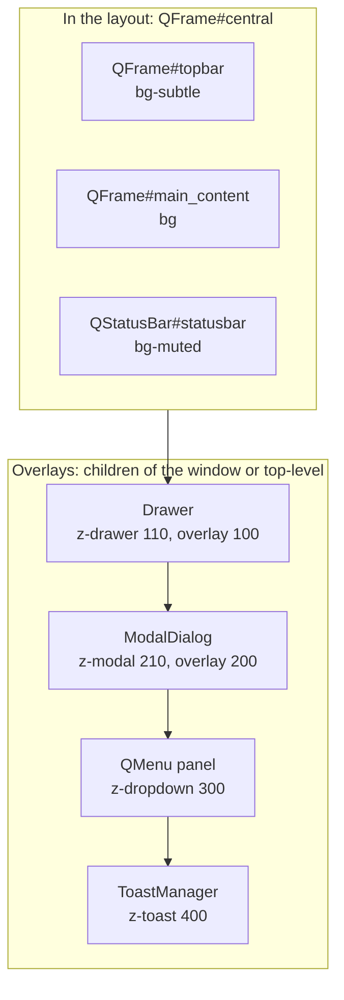
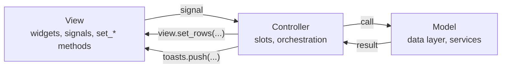
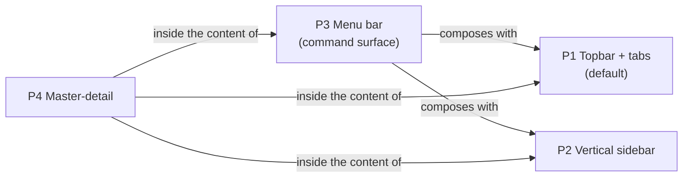

# Layout System - v4.2 (Python / PySide6)

> Companion layout reference, not a constraint. This file provides: (1) a **proposed default
> composition** and a **catalog of alternative composition patterns** (§12) that Claude co-designs
> from in Phase 3, the user amending or replacing freely;
> (2) the **feedback spec** (toasts, modals) serving the error contract; (3) **defaults and
> technical recommendations** (dimensions, behaviors) - never a composition restriction.
> The retained composition is the one validated in `docs/specs/03-surfaces.md` and locked in
> `docs/specs/04-architect.md`.
> Built on `design-system.md v2.1 (Python / PySide6)`. The two files are inseparable.
> Stack: Python 3.12+, PySide6 (Qt 6.8 or later), Fusion style, strict MVC, Windows.

## Changelog

| Version | Date       | Main change |
| ------- | ---------- | ----------- |
| v4.2    | 2026-10-25 | design-system v2.1 alignment: **surface ladder** applied to every zone (topbar, menu bar, sidebar, master list on `bg-subtle`; statusbar on `bg-muted`; modal and drawer on `bg-elevated`; canvas on `bg`) · default hex refreshed · hover step transparent → `border-strong` · control edge `border-strong` · selected items carry a 2px `primary` bar (`SelectionBarDelegate`) · pagination label and tree chevrons `text-subtle` · sidebar and master list rows are **widgets** in a `FittedList` (wrapped labels no longer truncated) · overlay behavior (focus moves in, Tab stays inside, `InertScope` behind the drawer, focus returns to the opener) · drawer and toasts span the bars actually mounted (`shell_top`, `shell_bottom`) · danger toast raises the `Alert` accessibility event · keyboard contracts for table, tree and menu bar · accessible names on every control · menu bar label padding `spacing-1` · new size tokens · measured sizes and a Windows validation list |
| v4.1    | 2026-07-16 | design-system v2.0 alignment: `SlidingUnderline` tab indicator (signature gesture) · hover = border strengthening · Lucide icon names (qtawesome note inverted) · drawer slide 240ms `ease-out`, no toast animations (motion policy) · floating layers (drawer, modal) marked by `border-strong` · default hex refreshed (accent-tinted neutrals) |
| v4.0    | 2026-07-14 | Composition pattern catalog (§12): vertical sidebar, menu bar, master-detail alternatives; Phase 3 becomes a guided co-design flow |
| v3.0    | 2026-07-13 | Non-binding composition: mandatory skeleton becomes the proposed default; caps become defaults/recommendations |
| v2.2    | 2026-06-14 | statusbar text `text-subtle` (WCAG) · dark toast tints · layering reference |
| v2.1    | 2026-06-12 | 6 toast positions specified · neutral tabs · preferences clarified |
| v2.0    | initial    | Global structure, topbar, drawer, statusbar, recurring components |

Every generated application references the active version in its `README.md`.

## Deviations from v4.1

| Area | v4.1 | v4.2 | Reason |
| ---- | ---- | ---- | ------ |
| Topbar and menu bar fill | `bg` | `bg-subtle` | chrome sits one level above the canvas |
| Modal fill | `bg` | `bg-elevated` | floating layer, level N3 |
| Statusbar fill hex | `#EEF1F4` / `#293138` | `#E6EBF0` / `#2B343C` | recomputed neutral surfaces (`design-system.md §2`) |
| Hover on neutral items | transparent → `border` | transparent → `border-strong` | 3:1 hover rule |
| Master list hover | border strengthening + `bg-subtle` cue | border strengthening only | the list is already on `bg-subtle`: the cue is invisible |
| Pagination label | `text-muted` | `text-subtle` | informational text is not exempt from AA |
| Tree chevrons | `text-muted` | `text-subtle` | a functional icon is not exempt from AA |
| Selected item | fill and text color | plus a 2px `primary` bar, painted by `SelectionBarDelegate` | WCAG 1.4.1 |
| Sidebar item label | `QListWidget.setWordWrap(True)` | a row widget (icon `QLabel` + wrapping `QLabel`) in a `FittedList` | measured: `setWordWrap` with QSS item padding truncated a three-line label to "..." |
| Master list rows | `QListWidget` items with text | row widgets (title + description) in a `FittedList` | QSS padding is not part of the item `sizeHint`; two-line rows overlapped |
| Tabs beyond 5 | `···` dropdown menu | `···` menu still recommended; not provided by the reference components | reference implementation limit |
| Menu bar label padding | `spacing-2` vertical | `spacing-1` vertical | a 14px label with `spacing-2` makes the bar about 41px and hides the labels in the overflow; with `spacing-1` it measures 33px |
| Menu bar height | 32px | 32px **minimum**; 33px measured | `QMenuBar` adds its `min-height` to the items: the token cannot be applied as a height |
| Drawer and toast extent | unspecified | between the bars actually mounted (`shell_top`, `shell_bottom`) | holds in P1, P2 and P3 |
| Drawer behavior | closes on Escape | plus focus moves in, Tab stays inside, page behind removed from the tab order, focus returns | WCAG 2.4.3 |
| Overlay colors | `text` 40 % opacity | `overlay` rgba literal | QSS has no opacity |
| Right zone of the topbar | fixed 40px | `spacing-2` padding around the 24px glyph: 41px measured (Fusion adds 3px to a `QToolButton`) | built from tokens |

---

## 1. GLOBAL STRUCTURE

Proposed default composition, submitted in Phase 3, amendable or replaceable by the user.

```
┌─────────────────────────────────────────────────────┐
│              TOPBAR (48px)                          │
│  [ Logo / Name ]  [ Nav tabs ]  [ Theme ]          │
├─────────────────────────────────────────────────────┤
│                                                     │
│            MAIN CONTENT                             │
│            (scrollable area)                        │
│                                                     │
├─────────────────────────────────────────────────────┤
│                STATUSBAR (28px)                     │
└─────────────────────────────────────────────────────┘
```

Proposed default widget skeleton (`views/main_window.py`):

```
QMainWindow
├── QFrame#central              QVBoxLayout, margins 0, spacing 0
│   ├── QFrame#topbar           min height topbar-height
│   └── QFrame#main_content     stretch 1: QStackedWidget (one page per tab)
├── QStatusBar#statusbar        setStatusBar()
├── ToastManager                overlaid child of the window
└── Drawer (+ overlay)          overlaid child of the window (optional)
```

```python
class MainWindow(QMainWindow):
    """Shell only: zones, overlays, theme. No business logic (strict MVC)."""

    def __init__(self, theme: str) -> None:
        super().__init__()
        central = Frame("central")                      # QFrame#central, N0 canvas
        column = QVBoxLayout(central)
        column.setContentsMargins(0, 0, 0, 0)
        column.setSpacing(0)
        self.topbar = Topbar("Atelier", ["Tableau de bord", "Clients"], theme, self.tr("Navigation principale"))
        self.pages = QStackedWidget()
        column.addWidget(self.topbar)
        column.addWidget(self.pages, 1)
        self.setCentralWidget(central)
        self.setStatusBar(Statusbar(self.tr("Prêt"), ""))
        self.toasts = ToastManager(self, theme)         # child of the window, raised above everything
        self.topbar.tab_bar.currentChanged.connect(self.pages.setCurrentIndex)
```

**Surface per zone** (`design-system.md §2`, surface ladder):

| Zone | Level | Fill | Edge |
| ---- | ----- | ---- | ---- |
| Main content, table bodies | N0 canvas | `bg` | none |
| Topbar, menu bar, sidebar, master list | N1 chrome | `bg-subtle` | 1px `border` toward the canvas |
| Statusbar | N1 | `bg-muted` | 1px `border` above |
| Cards, grouped panels | N2 panel | `bg-panel` | 1px `border` |
| Menu panel, modal, drawer | N3 floating | `bg-elevated` | 1px `border-strong` |

**Stacking** (back to front, scale from `design-system.md §13`):



**Right drawer** (optional, over the content):

```
┌─────────────────────────────────────────────────────┐
│                     TOPBAR                          │
├───────────────────────────────┬─────────────────────┤
│                               │                     │
│       MAIN CONTENT            │  DRAWER (320px)     │
│       (reduced)               │  sliding            │
│                               │                     │
├───────────────────────────────┴─────────────────────┤
│                   STATUSBAR                         │
└─────────────────────────────────────────────────────┘
```

**Toast** (overlaid, top-right corner):

```
┌─────────────────────────────────────────────────────┐
│                     TOPBAR              [ Toast 1 ] │
├─────────────────────────────────────────[ Toast 2 ]─┤
│                                                     │
│            MAIN CONTENT                             │
│                                                     │
├─────────────────────────────────────────────────────┤
│                   STATUSBAR                         │
└─────────────────────────────────────────────────────┘
```

**Strict MVC wiring.** A view holds widgets and emits signals; it never reads a database, a file or the network. The controller connects the signals, calls the model, and calls back into public view methods.



**Shell offsets (runtime, not authored).** Overlays that span the content (drawer, toasts) stay between the bars actually mounted. The main window exposes the two heights, computed from the widgets present (menu bar, topbar, statusbar), and `ToastManager` and `Drawer` read them:

```python
self.shell_top = (self.menuBar().height() if self.menuBar().isVisible() else 0) + self.topbar.height()
self.shell_bottom = self.statusBar().height()
```

Only `main_content`, drawer content, modal content and item views scroll; the window itself does not. Page content that can exceed the window height sits in a `QScrollArea` (`widgetResizable=True`, frameless).

---

## 2. WINDOW

Default values, customizable in Phase 3.

| Token / option    | Default |
| ----------------- | ------- |
| `minimumSize`     | 1024 × 768 (`setMinimumSize`) |
| position on launch | centered on the primary screen; when the persisted-position preference is on and a position was saved, that saved position is restored instead (centering is the first-launch / preference-off fallback). The saved position is clamped to an available screen |
| size on launch    | 1280 × 800; restored via the preference when enabled |
| theme on launch   | follows the OS theme (`QGuiApplication.styleHints().colorScheme()`); a saved preference wins |
| OS default theme  | light |
| title bar         | native Windows frame; no custom title bar |
| icon              | `resources/icon.ico` (provided by the user, otherwise the Qt default) |
| style             | `app.setStyle("Fusion")`, mandatory (`design-system.md §11`) |

```python
def center_on_primary(window: QWidget) -> None:
    geometry = window.frameGeometry()
    geometry.moveCenter(QGuiApplication.primaryScreen().availableGeometry().center())
    window.move(geometry.topLeft())
```

---

## 3. TOPBAR

| Token              | Default |
| ------------------ | ------- |
| height             | `topbar-height` = 48px (minimum: the bar grows with the text) |
| level              | N1 chrome |
| light mode bg      | `bg-subtle` = #F1F4F7 |
| dark mode bg       | `bg-subtle` = #1A2025 |
| bottom border      | 1px `border` |
| horizontal padding | `spacing-4` = 16px |
| widget             | `QFrame#topbar` (`Frame` subclass, `WA_StyledBackground`) |

### Topbar zones (left → right)

```
[ Logo / App name ]  [ Navigation tabs ]  ···  [ Theme ]
```

| Zone   | Content                       | Width |
| ------ | ----------------------------- | ----- |
| Left   | SVG logo 24px + app name      | fixed |
| Center | Navigation tabs (`QTabBar`)   | flexible, centered between two stretches |
| Right  | Light/dark theme selector     | fixed, 41px measured (`spacing-2` padding around the 24px glyph + 1px border + Fusion offset) |

### Logo / App name

- Lucide icon `icon-lg` (24px) in a `QLabel` + label `semibold` `base` (16px).
- Color: `text`.
- Not clickable. The logo is decorative (empty accessible name). No logo is imposed: without one, set the product name in plain type.

### Navigation tabs (`QTabBar#nav_tabs`)

- A `QTabBar` with `setDrawBase(False)`, `setExpanding(False)`, `setElideMode(ElideNone)` and an accessible name (default "Navigation principale"). Views are stacked in a `QStackedWidget` driven by `currentChanged`.
- Embedded in the topbar, center-aligned.
- 5 visible tabs recommended at most. Beyond 5, a `···` dropdown menu remains the recommended pattern but is not provided by the reference components.
- Labels never wrap or elide.
- Active tab: `primary` text; the selected indicator is the **signature underline**, the `SlidingUnderline` widget (2px accent) sliding to the active tab in 240ms `OutCubic` (`design-system.md §8`), never a QSS `border-bottom`. It snaps on resize and on first show, and when `ANIMATIONS_ENABLED` is `False`.
- Inactive tab: `text-subtle` text, transparent background, 1px transparent border.
- Hover: border strengthening, transparent border → `border-strong` (`design-system.md §8`), instant. Press: `bg-muted`.
- Focus policy `TabFocus`: the ring shows for the keyboard only; the ring is drawn inset (2px `primary` border).
- Font: `medium` `sm` (14px).
- Tab height: fills the topbar (47px + the bar's 1px bottom border = `topbar-height`).
- Horizontal padding per tab: `spacing-4` = 16px.
- `Alt+1…9` jumps to tab N (§9).

### Theme selector

- An `IconButton` (`QToolButton`, icon only): Lucide `moon` in light, `sun` in dark, size `icon-lg` = 24px.
- Mandatory tooltip **and** accessible name: "Passer en mode sombre" / "Passer en mode clair".
- Instant toggle: the controller calls `apply_theme(app, theme)` (`design-system.md §2`), then `view.set_theme(theme)` on every view that holds recolored icons, delegates or the underline; the choice is persisted in preferences.

---

## 4. MAIN CONTENT AREA

| Token             | Default |
| ----------------- | ------- |
| level             | N0 canvas |
| light mode bg     | `bg` = #FFFFFF |
| dark mode bg      | `bg` = #111519 |
| inner padding     | `spacing-6` = 24px (`setContentsMargins`) |
| scroll            | vertical, `QScrollArea` around the page |
| max content width | `content-xl` = 1024px (centered) |
| widget            | `QFrame#main_content` |

A master-detail content (P4) is mounted flush: no padding, no maximum width.

### Section header

```
[ Section title ]   [ Subtitle / short description ]
```

- One per view, at the top of `main_content`. Not used inside a modal or drawer (those carry their own `lg` title).
- Title: `bold` `2xl` (24px), `leading-tight`, color `text` (`QLabel[role="section-title"]`).
- Subtitle: `normal` `sm` (14px), color `text-subtle` (`QLabel[role="section-subtitle"]`).
- Bottom margin: `spacing-6` = 24px before the content.

---

## 5. TOAST

Fully replaces the inline banner. No inline banner in the applications.
Component: `views/toast_manager.py`: `ToastManager` (a child widget of the window) stacks `Toast` frames in a `QVBoxLayout`.

### Position - Phase 3 choice

6 positions available. Default: `top-right`.

| Position        | Anchor          |
| --------------- | --------------- |
| `top-right`     | top + right     |
| `top-left`      | top + left      |
| `top-center`    | top + center    |
| `bottom-right`  | bottom + right  |
| `bottom-left`   | bottom + left   |
| `bottom-center` | bottom + center |

> Motion policy (`design-system.md §6`): **no entry/exit animation**: toasts appear and disappear instantly, and the stack reflows without animation. The only animated visuals are the drawer slide and the signature underline.

### Margins and stacking

| Token                          | Value |
| ------------------------------ | ----- |
| width                          | `toast-width` = 320px (fixed) |
| margin from edge               | `spacing-4` = 16px |
| margin from topbar / statusbar | `spacing-4` = 16px (per top/bottom anchor), measured from the bars actually mounted (`shell_top`, `shell_bottom`) |
| spacing between toasts         | `spacing-2` = 8px |
| stacking                       | Vertical, queue, no overlap |
| stacking direction (top)       | new toast on top, older ones descend (`insertWidget(0, ...)`) |
| stacking direction (bottom)    | new toast at bottom, older ones rise (`addWidget`) |

### Implementation

- `ToastManager(host, theme, position=config.TOAST_POSITION)`; `config.TOAST_POSITION` = `"top-right"` by default, modified per Phase 3 choice.
- `reposition()` computes the anchor from the host `width()` / `height()` and its `shell_top` / `shell_bottom`; it runs after each push, each close and each host resize (`resizeEvent` of the window).
- After every `push`, the manager calls `raise_()`: toasts stay above the drawer and the page.
- A modal is a top-level window: while it is open, `set_host(modal)` re-hosts the stack so a toast stays above it; `set_host(window)` restores it on close.
- The consumer (controller) owns the timers: `QTimer.singleShot(duration, toast.close_toast)`.

### Display durations

| Type      | Duration   | Manual dismiss    | Accessibility |
| --------- | ---------- | ----------------- | ------------- |
| `success` | 4s         | No                | plain accessible text |
| `info`    | 4s         | No                | plain accessible text |
| `warning` | 6s         | Yes (×)           | plain accessible text |
| `danger`  | persistent | Yes (×) mandatory | `QAccessible.Event.Alert` raised on push |

### Toast anatomy

```
┌────────────────────────────────────┐
│ [icon]  Main message           [×] │
│         Optional description       │
└────────────────────────────────────┘
```

| Token            | Value |
| ---------------- | ----- |
| widget           | `QFrame#toast`, dynamic property `tone` (`success`, `warning`, `danger`, `info`) |
| padding          | `spacing-3` vertical, `spacing-4` horizontal |
| left border      | 4px (`border-width-accent`) semantic color, no other border |
| bg               | semantic bg (`*-50`) |
| radius           | `radius` |
| message font     | `medium` `sm` (14px), color `text` (`toast-message`) |
| description font | `normal` `xs` (12px), `text-subtle` (`toast-description`) |
| icon             | `icon-md` = 20px |
| close button     | `IconButton("x")`, tooltip and accessible name from the translated "Fermer" |

| Type      | Bg           | Border        | Icon (Lucide)  |
| --------- | ------------ | ------------- | -------------- |
| `success` | `success-50` | `success-600` | `circle-check` |
| `warning` | `warning-50` | `warning-600` | `triangle-alert` |
| `danger`  | `danger-50`  | `danger-600`  | `circle-x`     |
| `info`    | `info-50`    | `info-600`    | `info`         |

> `*-50` is the toast surface role: pale tint in light, deep tint in dark (each sheet holds its own value, `design-system.md §2`). Info takes the accent itself (`primary-bg` surface, `primary` edge and icon). Toast message text uses `text`, never the tone color. Toast icons use the matching `ICON_COLORS` entry per theme. The icon shape repeats the tone, so color never carries the status alone.
> Layering: toasts sit above modals (`z-toast` = 400, `design-system.md §13`), so a persistent `danger` toast is never hidden.

---

## 6. RIGHT DRAWER

Optional component. Default values below.

| Token         | Default |
| ------------- | ------- |
| level         | N3 floating layer |
| width         | `drawer-width` = 320px; shrinks to the window width on a narrow window |
| animation     | slide from the right, `ANIM_SLOW_MS` = 240ms `OutCubic` (`QPropertyAnimation` on `pos`); snaps when `ANIMATIONS_ENABLED` is `False` |
| light mode bg | `bg-elevated` = #FFFFFF |
| dark mode bg  | `bg-elevated` = #222930 |
| left border   | 1px `border-strong` (floating layer, `design-system.md §5`) |
| padding       | `spacing-6` = 24px |
| overlay bg    | `overlay` = `text` at alpha 0.4 (`rgba(15, 24, 30, 102)` light, `rgba(242, 245, 247, 102)` dark) |
| extent        | between the bars actually mounted: top at `shell_top`, bottom at `shell_bottom` |
| widgets       | `QWidget#drawer_overlay` + `QFrame#drawer`, children of the window |

- Opened by explicit action only. Never automatically.
- Close: click overlay, Escape key, or × button in the drawer.
- Drawer header: `semibold` `lg` (18px) title + × button aligned right.
- Drawer content: vertically scrollable on overflow.
- Behavior while open: focus moves to the close button (or the first field of the content); Tab and Shift+Tab stay inside the drawer; the page behind is removed from the tab order (`InertScope.engage(window_content)`: Qt has no `inert`); Escape closes; on close `InertScope.release()` restores every focus policy and focus returns to the opener.
- Layers: overlay `z-drawer-overlay`, drawer `z-drawer`.
- Not combined with a master-detail pane: the detail pane makes it redundant.

---

## 7. STATUSBAR

Default values below.

| Token              | Default |
| ------------------ | ------- |
| height             | `statusbar-height` = 28px (`min-height: 27px` + 1px top border) |
| level              | N1 chrome, one step darker than the topbar |
| light mode bg      | `bg-muted` = #E6EBF0 |
| dark mode bg       | `bg-muted` = #2B343C |
| top border         | 1px `border` |
| horizontal padding | `spacing-4` = 16px |
| font               | `normal` `xs` (12px), tabular digits |
| text color         | `text-subtle` |
| widget             | `QStatusBar#statusbar`, `setSizeGripEnabled(False)` |

> WCAG: `text-subtle` on `bg-muted` measures 4.90:1 in light and 5.61:1 in dark (AA 4.5:1). Essential or error status uses `text` for full contrast. `text-muted` is reserved for disabled/decorative use (see `design-system.md §12`).

### Statusbar zones (left → right)

```
[ Status message ]  ···  [ Progress ]  [ Contextual info ]
```

| Zone   | Content |
| ------ | ------- |
| Left   | Current status message ("Prêt", "Chargement…", "3 éléments sélectionnés"): `addWidget(label, 1)` |
| Center | Compact `QProgressBar` (8px = `spacing-2`, chunk `primary`, no text): visible only when an operation is running |
| Right  | Fixed contextual info (record count, version, DB connection…): `addPermanentWidget` |

---

## 8. RECURRING COMPONENTS

### Data table (`QTableView#data_table`)

- Model: `QStandardItemModel` (or a project model) behind a `QSortFilterProxyModel` with `sortRole = Qt.UserRole`; each item stores its typed value in `UserRole`, so numbers sort as numbers ("2" before "10").
- Body on `bg` (N0). When the table sits on a panel (N2), frame it with a 1px `border`; never place the body on `bg-subtle`.
- Header: `bg-subtle` bg, `semibold` `sm` (14px), `text-subtle`, left-aligned text.
- Header bottom border: 2px `border-strong`.
- Row: dynamic height (vertical padding `spacing-2` = 8px), cell horizontal padding `spacing-3`, 1px `border-subtle` bottom border.
- Columns: dynamic width (`resizeColumnsToContents`), the last column stretches (`setStretchLastSection(True)`). Exception: actions column, fixed width per content.
- Numeric columns: right aligned, tabular digits (`QFont.setFeature(QFont.Tag("tnum"), 1)`).
- Column sorting: `setSortingEnabled(True)`; the table starts unsorted (`setSortIndicator(-1, ...)`); clicking a header sorts by it and a second click reverses the order (ascending, then descending). The active column shows the native `QHeaderView` sort indicator (painted by Fusion with the `QPalette` text color); one sort column at a time. A presentational column such as the actions column is not sortable.
- Selected row: `primary-bg` bg **plus a 2px `primary` bar** on the leading edge of the first cell (`SelectionBarDelegate`).
- Row hover: bottom border strengthens `border-subtle` → `border`, plus the `bg-subtle` secondary cue allowed on wide rows (`design-system.md §8`).
- Row alternation: disabled (`setAlternatingRowColors(False)`; uniform surfaces, depth by stroke).
- Keyboard (native Qt, `StrongFocus`, `SelectRows`, `SingleSelection`): one tab stop; Up, Down, Home, End, Page Up and Page Down move between rows; Space and Enter select; the vertical header is hidden.
- Row actions are named with their row (`setAccessibleName("Supprimer Dupont")`): a bare "Supprimer" repeated down the column is not usable with a screen reader. The table takes an accessible name.
- Pagination below the table recommended beyond ~50 rows.

### Input form

- Labels above the fields, `medium` `sm` (14px), `text` (`QLabel[role="field-label"]`). Never beside or inside the field. The label text is the field's accessible name (`setAccessibleName`), and `QLabel.setBuddy(field)` links the two.
- Fields: `QLineEdit`, stretched width in the container (`setSizePolicy(Expanding, Fixed)`), dynamic height (vertical padding `spacing-2` = 8px; 37px measured), horizontal padding `spacing-3`.
- Field edge: 1px `border-strong` at rest (control edge, 3:1), `text-subtle` on hover, focus ring 2px `primary` drawn inside (padding shrinks by 1px).
- Spacing between fields: `spacing-4` = 16px.
- Field in error (`QLineEdit[error="true"]`, then `repolish`): 2px `danger-600` border + `danger-600` message below the field, `xs` (12px, `QLabel[role="field-error"]`). An error is never signalled by color alone: always write the message, and set it as the field's accessible description.
- Form actions: aligned right, Cancel (secondary) + Confirm (primary), dynamic width per label.
- Submission through a controller slot connected to `returnPressed` and the Confirm button.

### Tree view (`QTreeView#tree`)

- Indentation per level: `spacing-4` = 16px (`setIndentation(16)`, same step at every level).
- Expand/collapse icon: Lucide `chevron-right` / `chevron-down` in QSS `::branch` rules, `icon-sm` = 16px, `icon-default` (`text-subtle`); the image path is the recolored SVG substituted at load (`design-system.md §10`). A leaf keeps a blank slot of the same width.
- Item height: dynamic (vertical padding `spacing-1` = 4px).
- Selected item: `primary-bg` bg **plus a 2px `primary` bar** at the viewport edge (`SelectionBarDelegate`, x = 0 for trees). Never the underline.
- Hover: item border from transparent to `border-strong`; press `bg-muted`.
- Keyboard (native Qt): one tab stop; Up and Down move, Home and End jump, Right expands or enters the first child, Left collapses or goes to the parent, Enter and Space activate. The focus ring is drawn inset on the row.
- The tree takes an accessible name.

### Charts / Visualization

- Background: transparent (inherits the main content).
- Palette: `chart-primary`, `chart-success`, `chart-warning`, `chart-danger`, `chart-info`.
- Hue alone never separates two series: add a marker shape, a dash pattern or a direct label; keep ≥ 1.5:1 of lightness between neighbouring series. `chart-info` equals `chart-primary`: never plot both in one chart.
- Legend: `normal` `sm` (14px), `text-subtle`.
- No shadow (`design-system.md §5`, depth by stroke).
- Chart library: to validate in Phase 1 (none by default; Qt Charts or Matplotlib are candidates, with colors read from `config`).

### Modal (`ModalDialog`, a `QDialog`)

```
┌─────────────────────────────────────┐
│  Modal title                    [×] │
├─────────────────────────────────────┤
│                                     │
│  Content (form, text…)              │
│                                     │
├─────────────────────────────────────┤
│              [ Cancel ] [ Confirm ] │
└─────────────────────────────────────┘
```

Construction: a frameless, translucent top-level `QDialog#modal_overlay` that covers the parent window (`overlay` fill, painted in `paintEvent` with `PE_Widget`: a translucent top-level does not paint its QSS background otherwise), holding a centered `QFrame#modal` panel. `WindowModal` blocks its parent window while `exec()` runs.

| Token         | Default |
| ------------- | ------- |
| level         | N3 floating layer |
| width         | dynamic per content, min `modal-min-width` = 480px (never wider than the window) |
| light mode bg | `bg-elevated` = #FFFFFF |
| dark mode bg  | `bg-elevated` = #222930 |
| border        | 1px `border-strong` (floating layer, `design-system.md §5`) |
| radius        | `radius` |
| padding       | `spacing-6` = 24px |
| overlay bg    | `overlay` (`text` at alpha 0.4) |
| layers        | overlay `z-modal-overlay`, panel `z-modal` |

- Opened by explicit action only.
- Close: × button, Cancel, Escape key, or click outside the panel (all call `reject()`).
- Header: `semibold` `lg` (18px) title + × button on the right, 1px `border-subtle` bottom border.
- Footer: actions on the right, Cancel (secondary) then Confirm (primary, or danger for a destructive action), 1px `border-subtle` top border.
- Content: vertically scrollable on overflow; the panel height is fitted to the wrapped content (`layout.totalHeightForWidth`), so a long message is never clipped.
- Zero native `QMessageBox`: use this styled `QDialog`. A native file dialog stays allowed where the OS picker is the expected control.
- Behavior while open: window modality blocks the window behind; focus moves to Cancel (the safe default; for a form, the first field); Tab and Shift+Tab cycle inside the dialog (verified: Cancel, Confirm, Close); on close, focus returns to the opener. The dialog is named by its title (`setAccessibleName`). With several overlays open, only the top one reacts to Escape.

### Pagination

Shown below a table when it grows long, beyond ~50 rows by default.

```
[ ← ]  [ 1 ]  [ 2 ]  [ 3 ]  ···  [ 12 ]  [ → ]
                  Page 2 sur 12
```

| Token              | Default |
| ------------------ | ------- |
| position           | below the table, aligned right |
| spacing from table | `spacing-4` = 16px |
| page button        | `QPushButton[role="page"]`, dynamic per number, padding `spacing-2` horizontal; accessible name "Page N" |
| active button      | `primary-bg` bg, `primary` text, 2px `primary` bar on the bottom edge (`[active="true"]`, then `repolish`) |
| inactive button    | transparent, `text-subtle` text, 1px transparent border |
| button hover       | border strengthening, transparent → `border-strong` (`design-system.md §8`) |
| ← → buttons        | `icon-sm` chevrons (`chevron-left`, `chevron-right`), disabled on first/last page |
| page label         | `normal` `xs` (12px), `text-subtle`, centered below the buttons; the controller announces a page change through the label text |
| visible pages      | 5 numbers by default (first, last and the neighbors of the current page), `···` ellipsis for the gaps (`visible_pages(page, count)`) |

Nothing renders when the page count is below 1.

---

## 9. GLOBAL KEYBOARD NAVIGATION

Default shortcuts, customizable in Phase 3.

| Shortcut            | Action |
| ------------------- | ------ |
| `Tab` / `Shift+Tab` | Navigate between interactive elements |
| `Enter` / `Space`   | Activate focused button / item |
| `Escape`            | Close active drawer / modal / menu (only the top overlay reacts) |
| `Alt+1…9`           | Direct navigation to tab N |
| `Ctrl+,`            | Open Settings |

- Shortcuts are `QShortcut(QKeySequence(...), window)` with `Qt.ShortcutContext.WindowShortcut`, created by the controller.
- `Alt+1…9` is disabled while a drawer is open; an open modal blocks it natively. **To validate on a French AZERTY keyboard**: digits need Shift there, so check that `Alt+1` reaches tab 1; if not, compare `QKeyEvent.nativeScanCode()` (0x02 to 0x0A) in an event filter (`design-system.md §14`).
- Inside an open modal or drawer, Tab and Shift+Tab stay in the overlay (§6, §8).

Component-level contracts:

| Component | Keys |
| --------- | ---- |
| Navigation tabs | one tab stop (`TabFocus`); Left and Right change the current tab |
| Data table (selectable rows) | one tab stop; Up, Down, Home, End move; Enter, Space select |
| Tree | one tab stop; Up, Down, Home, End move; Right expands or enters; Left collapses or goes to parent; Enter, Space activate |
| Menu bar (P3) | native Qt: Alt focuses the bar, Left and Right move between menus, Down or Enter open, Up and Down move in the panel, a mnemonic letter (`&Fichier`) jumps, Escape closes |

---

## 10. PERSISTED PREFERENCES

`preferences.json` file at the project root (gitignored).
In `.exe` packaging mode: `%APPDATA%/[AppName]/preferences.json` (see `@rules/config.md`).

| Preference         | Default value |
| ------------------ | ------------- |
| theme              | OS system |
| window size        | 1280×800 |
| window position    | centered |
| drawer state       | closed |
| sidebar collapsed (P2) | expanded |
| language (if i18n) | fr |
| toast position     | top-right |

Read/write via `utils/helpers.py`: `load_preferences()` / `save_preferences(data)`. The controller reads them at startup and writes them on change; a view never touches the file.

**Language (i18n).** French is the default; English is the second language. Every visible string, tooltip, accessible name and placeholder goes through `self.tr(...)` (context = the view class), including those of the design-system components (theme selector, close buttons, "Page N", "Page 2 sur 12"). Switching language installs another `QTranslator`; each view re-applies its strings in `changeEvent` on `QEvent.Type.LanguageChange`. Sizes never depend on a text length: wrapping labels (sidebar) and dynamic widths absorb the difference.

---

## 11. DESIGN SYSTEM CROSS-REFERENCE

This file does not redefine tokens, it consumes them. Every visual value is traced to `design-system.md v2.1 (Python / PySide6)`.

| Need                       | Token |
| -------------------------- | ----- |
| Canvas (content, table bodies) | `bg` |
| Chrome (topbar, menu bar, sidebar, master list) | `bg-subtle` |
| Statusbar, open-menu label, press feedback | `bg-muted` |
| Panels and cards            | `bg-panel` |
| Floating layers (drawer, modal, menu panel) | `bg-elevated` |
| Primary text               | `text` |
| Secondary text, statusbar, pagination label | `text-subtle` |
| Disabled / decorative only | `text-muted`, `disabled-*` |
| Borders                    | `border` / `border-subtle` / `border-strong` |
| Control edge (field, Secondary button) | `border-strong` |
| Active / selection color   | `primary` / `primary-bg` + 2px `primary` bar |
| Danger button fill         | `danger-fill` |
| Focus                      | `focus-ring`: 2px inset, `text` on filled buttons |
| Easing                     | `ease-out` (`QEasingCurve.OutCubic`) |
| Panel animations           | `ANIM_SLOW_MS` = 240ms (drawer, underline) |
| State changes              | instant, QSS cannot transition (`design-system.md §6`) |
| Shape                      | `radius` = 5px (nested: 3px) |
| Shadows                    | none, floating layers marked by `border-strong` |
| Line-height                | `leading-tight` 1.25 / `leading-normal` 1.5 |
| Overlay                    | `overlay` (`text` at alpha 0.4) |
| Stacking order             | layering scale (`design-system.md §13`) |
| Fixed layers between bars  | `shell_top`, `shell_bottom` (§1) |
| Pattern sizes              | `sidebar-width`, `master-width`, `menubar-height`, `menu-min-width` |
| Feedback sizes             | `toast-width`, `modal-min-width`, `drawer-width` |

---

## 12. COMPOSITION PATTERNS

Catalog of alternative composition patterns for the Phase 3 co-design flow. The default composition (§1-§10) is pattern **P1**. Each pattern below is a starting point the user may amend or replace; dimensions are defaults. The retained composition is recorded in `docs/specs/03-surfaces.md` and locked in `docs/specs/04-architect.md`. The feedback spec (§5 toasts, §8 modals) applies to every pattern.



### P1 - Topbar + tabs (default)

Horizontal navigation embedded in the topbar, the composition proposed by default in Phase 3.

**Structure**: see §1 (shell, drawer, toast overlay) and §3 (topbar zones, tabs, theme selector). Not repeated here.

| Element         | Default |
| --------------- | ------- |
| topbar          | `topbar-height` = 48px, `bg-subtle` (§3) |
| navigation tabs | `QTabBar#nav_tabs`, centered in the topbar, 5 visible at most (§3) |
| statusbar       | `QStatusBar#statusbar`, `statusbar-height` = 28px, `bg-muted` (§7) |

**When to recommend**: 2-5 top-level views of comparable weight, flat hierarchy, no sub-navigation.

**Implementation notes**: `objectName` anchors `central`, `topbar`, `nav_tabs`, `main_content`, `statusbar` (§1). Views stacked in a `QStackedWidget` driven by the `QTabBar` current index. `setDrawBase(False)` on the tab bar and `app.setStyle("Fusion")` stay mandatory (`@rules/qss.md`). The selected indicator is the `SlidingUnderline` widget (`views/sliding_underline.py`, `design-system.md §8`), repositioned on tab change (animated) and on resize (snap).

**Interactions**: toasts (§5), drawer (§6), statusbar (§7), and modals (§8) unchanged. Master-detail (P4) may be used inside a tab.

### P2 - Vertical sidebar

Left navigation column, for many sections or sections carrying sub-items.

**Structure**

```
┌──────────┬──────────────────────────────────────────┐
│ SIDEBAR  │        TOPBAR (reduced, optional)        │
│ (240px)  ├──────────────────────────────────────────┤
│          │                                          │
│ [ico] …  │            MAIN CONTENT                  │
│ [ico] …  │            (scrollable area)             │
│ [ico] …  │                                          │
├──────────┴──────────────────────────────────────────┤
│                 STATUSBAR (28px)                    │
└─────────────────────────────────────────────────────┘
```

Proposed widget skeleton:

```
QFrame#central               QVBoxLayout
├── QHBoxLayout              stretch 1
│   ├── Sidebar (QFrame#sidebar)    fixed width: sidebar-width, or the collapsed width
│   └── QVBoxLayout
│       ├── QFrame#topbar           reduced (title + global actions), optional
│       └── QFrame#main_content
QStatusBar#statusbar          spans the full window width
```

| Element               | Default |
| --------------------- | ------- |
| width (expanded)      | `sidebar-width` = 240px (never more than 40% of a narrow window) |
| width (collapsed)     | icons only: 72px as built (`icon-lg` + `spacing-4` on each side + `spacing-2` of list margin on each side) |
| bg                    | `bg-subtle` (N1 chrome) |
| right border          | 1px `border` |
| item                  | icon `icon-md` (20px) + label `medium` `sm` (14px) |
| item label            | word-wraps within the width (a wrapping `QLabel` in the row widget), never elided or truncated, so long labels stay fully visible |
| item vertical padding | `spacing-2` = 8px (carried by the row widget, 7px + the 1px item border) |
| active item           | `primary` text, `primary-bg` background, **2px `primary` bar on the leading edge** (`design-system.md §8`: vertical nav has no underline) |
| inactive item         | `text-subtle` text, transparent background, 1px transparent border |
| hover                 | border strengthening, transparent → `border-strong` (`design-system.md §8`), instant |
| collapsed item        | carries its label as tooltip |
| collapse toggle       | optional, state persisted like the drawer (§10) |
| topbar (if kept)      | reduced to app name + global actions (theme), `topbar-height` = 48px |

**When to recommend**: more than 5 top-level views; grouped sections or sub-items; long labels that would crowd a topbar; a navigation the user wants always visible.

**Implementation notes**: `Sidebar(Frame)` with `objectName: sidebar`, holding a `FittedList` (`QListWidget#sidebar_list`, `setItemWidget` per row; never a `QTabBar` rotated). Each row widget is transparent to mouse events (`WA_TransparentForMouseEvents`) so the list handles selection. The active label carries the dynamic property `selected` (`QLabel[role="nav-label"][selected="true"]`, then `repolish`); the icon is re-rendered with the `active` color key. The list sets `setItemDelegate(SelectionBarDelegate)` for the 2px bar. Views still live in a `QStackedWidget`; the list's `currentRowChanged` drives its index. The collapsed state is a persisted preference (§10), like the drawer. Row heights come from `FittedList.fit_rows()` (recomputed on resize and show), never from QSS padding.

**Interactions**: toasts (§5) keep their 6 positions and their margins (the manager anchors on the window and `shell_top`); the drawer (§6) still overlays the content; the statusbar (§7) spans the full width. Master-detail (P4) may compose inside `main_content`.

### P3 - Menu bar

A classic File/Edit/View command bar above the content, for command-driven, document-oriented apps.

**Structure**

```
┌─────────────────────────────────────────────────────┐
│  File   Edit   View   Help          MENU BAR (32px) │
├─────────────────────────────────────────────────────┤
│              TOPBAR (optional)                      │
├─────────────────────────────────────────────────────┤
│            MAIN CONTENT                             │
│            (scrollable area)                        │
├─────────────────────────────────────────────────────┤
│                STATUSBAR (28px)                     │
└─────────────────────────────────────────────────────┘
```

| Element          | Default |
| ---------------- | ------- |
| height           | `menubar-height` = 32px (minimum: the bar grows with the text; 33px measured) |
| bg               | `bg-subtle` (N1 chrome) |
| bottom border    | 1px `border` |
| menu label       | `medium` `sm` (14px), `text` |
| label padding    | `spacing-1` vertical, `spacing-3` horizontal on the item; the bar adds 3px vertical padding |
| label hover      | border strengthening, transparent → `border-strong` (`design-system.md §8`) |
| label open       | `bg-muted` background (open-state feedback) |
| open panel       | `bg-elevated` bg, 1px `border-strong` (floating layer), `radius`, min-width `menu-min-width` = 200px |
| panel item       | `sm` (14px), padding `spacing-2` / `spacing-4`, hover border strengthening; nested radius 3px |
| separator        | 1px `border-subtle` |
| disabled item    | `text-muted`, `QAction.setEnabled(False)` |
| layering         | `z-dropdown`: `QMenu` is its own popup window |

**Keyboard**: native Qt behavior (§9): Alt focuses the bar, Left and Right move between menus, Down or Enter open, a mnemonic (`&Fichier`) jumps, Escape closes.

**When to recommend**: many commands for few views (editor, document tool, admin console); actions that do not map onto navigation tabs; users expecting the File/Edit/View convention.

**Implementation notes**: native `QMenuBar` (`objectName: menu_bar`, `WA_StyledBackground`) + `QMenu` / `QAction`. Qt's menu bar **is** QSS-stylable (`QMenuBar`, `QMenuBar::item`, `QMenu`, `QMenu::item`, `QMenu::separator`), so no custom widget is needed; each rule carries its `/* token : … */` comment. `app.setStyle("Fusion")` stays mandatory: the native Windows style ignores part of the QSS here too. **Do not set `min-height` or `max-height` on `QMenuBar`**: it is added to the items and pushes them out of the bar into the "»" overflow. `QAction` signals are wired by the controller, never by the view. Menu titles go through `tr()` with an `&` mnemonic.

**Interactions**: toasts (§5), drawer (§6), statusbar (§7), and modals (§8) unchanged. The menu bar is a **command** surface: it composes with a navigation surface (tabs P1 or sidebar P2) rather than replacing it. Commands do not belong in the topbar.

### P4 - Master-detail

List panel + detail panel, for one dominant entity browsed and inspected item by item.

**Structure**

```
┌─────────────────────────────────────────────────────┐
│                     TOPBAR                          │
├────────────────────┬────────────────────────────────┤
│  MASTER LIST       │  DETAIL PANE                   │
│  (320px)           │  (flexible)                    │
│  [ item ]          │  [ title + item actions ]      │
│  [ item selected ] │  [ fields / sections ]         │
│  [ item ]          │                                │
├────────────────────┴────────────────────────────────┤
│                   STATUSBAR                         │
└─────────────────────────────────────────────────────┘
```

| Element             | Default |
| ------------------- | ------- |
| master list width   | `master-width` = 320px (never more than 50% of a narrow window) |
| resizable split     | optional: `QSplitter` handle 4px, `border` (the handle rule is not in the reference sheet; add `QSplitter::handle { background-color: <border> }` if used) |
| list bg             | `bg-subtle` (N1 chrome) |
| separator           | 1px `border` |
| list item padding   | `spacing-2` vertical, `spacing-4` horizontal (row widget) |
| list item separator | 1px `border-subtle` |
| selected item       | `primary-bg` background **plus a 2px `primary` bar** on the leading edge (same role as the table row, §8) |
| item hover          | border strengthening, transparent → `border-strong`. The `bg-subtle` secondary cue has no effect on a `bg-subtle` list, so hover shows by border only |
| detail padding      | `spacing-6` = 24px |
| empty state         | centered message, `text-subtle` `sm` (14px) |
| list header actions | add / refresh, top of the list panel |

**When to recommend**: a dominant entity listed and inspected/edited one at a time (records, orgs, files); the user needs the list and the detail visible together; it replaces the table → dialog round trip.

**Implementation notes**: a `QSplitter` (or a fixed-width list in a `QHBoxLayout`) holding `master_list` (`MasterList(FittedList)`, `QListWidget#master_list`, one row widget per item: title `field-label`, description `muted`) and `detail_pane` (`QFrame#detail_pane`, `bg`). Mount flush (§4). The view emits the selection signal (`currentRowChanged`); the controller loads the detail and calls back into the view (`@rules/mvc.md`: no business logic in the view). The detail pane shows an explicit empty state when nothing is selected. Item actions live in the detail header, list-level actions in the list header.

**Interactions**: composes inside the content area of P1, P2, or P3. Toasts (§5) and modals (§8) unchanged: a destructive confirmation stays a styled `QDialog` (§8), never a `QMessageBox`. The right drawer (§6) is usually redundant with the detail pane: pick one.
